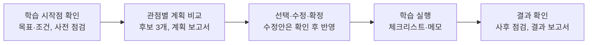

# GrowPath

**개발·운영 직군 AI 역량 성장 지원 서비스**
피드백을 통한 보완에서 스스로 그리는 성장 로드맵까지

| 항목 | 내용 |
|---|---|
| 과정 | SK네트웍스 Family AI 캠프 33기 최종 프로젝트 2팀 **부산별빛샌드** |
| 주제 | 다중 에이전트 기반 업무 활용 플랫폼 |
| 기간 | 2026.09.28 ~ 2026.11.20 (8주) |
| 팀원 | 송지섭(PM), 신가을(APM), 오호민, 이준희, 김영석 |

> **현재 단계 (10/14 기준)**: 3주차. 데이터 전처리와 DB 설계를 진행하며 중간 발표를 준비하고 있습니다. 제출 산출물 5종은 [`docs/`](docs/)에 보관합니다. 공식 제출 링크는 [산출물 관리 시트 2팀 탭](https://docs.google.com/spreadsheets/d/1EQeYN_FpKWzzxHUdtjG9WYaP9t43bvf-H5e1jGMTMEM/edit?gid=1029234216)에서 확인합니다.

<br>

## 1. 프로젝트 소개

| 항목 | 내용 |
|---|---|
| 한 줄 소개 | 개발·운영 직군 직원의 AI 역량 성장을 돕는 서비스 |
| 대상 사용자 | 한국수자원공사 AI본부의 가상 개발·운영 직무 부서 직원 |
| 기준 자료 | 한국수자원공사가 공개한 내부 업무 문서(사내 규정, 기관 내 AI 활용 사례) |

**이용자 구분 및 주요 역할**

| 이용자 | 주요 역할 |
|---|---|
| 개인 사용자 | 목표와 학습 조건을 입력하고 로드맵 후보를 선택·수정·확정합니다. 실행 과정을 기록하고 사전·사후 점검으로 성장 정도를 확인하며, 챗봇으로 궁금한 내용을 질문합니다. |
| 상급자 | 소속 직원의 로드맵과 진행 상황을 수시로 확인하고, 성장 계획이 업무에 적합한지 코멘트합니다. |
| 시스템 관리자 | 규정·직원 정보를 등록·수정하고 버전을 관리하며, 교육 수요를 집계합니다. |

<br>

## 2. 주요 기능



규정 질문은 화면 하단 챗봇으로 언제든 묻고, 상급자는 소속 직원의 로드맵과 진행 상황을 수시로 확인하며 확정된 로드맵에 코멘트합니다.

| 기능 | 내용 |
|---|---|
| ① 학습 수준 점검 | 목표와 학습 선호에 맞춰 사전 점검 문항을 만들고, 사후에 같은 문항으로 다시 점검합니다. 점수 계산은 프로그램이 합니다 |
| ② 로드맵 후보·계획 보고서 | 같은 목표와 시간·예산 한도 안에서 관점(예: 비용·시간·업무 적용)만 다른 후보 3개를 만들고 비교합니다. 수정 요청은 수정안을 먼저 보여 주고 확정 전까지 기존 로드맵을 유지합니다 |
| ③ 실행·결과 보고서 | 활동 완료 여부와 메모를 기록하고, 사후 점검 뒤 변화·보완점·다음 계획을 정리합니다 |
| ④ 하단 챗봇 | 등록된 규정 원문에서 조항을 찾아(RAG) 대상·한도·승인·기간을 대조해 답합니다. 근거가 없으면 확인할 수 없다고 안내하고, 규정 외 일반 질문은 일반 답변으로 표시합니다. 로드맵·점검 요청은 메뉴로 안내하며, 승진·발령·보수·성과급 상담은 답하지 않고 다룰 수 없다고 안내합니다 |
| ⑤ 상급자 코멘트 | 상급자는 알림 수신 여부와 관계없이 소속 직원의 로드맵과 진행 상황을 확인하고, 확정된 로드맵에 코멘트할 수 있습니다. 직원은 코멘트를 반영해 로드맵을 고칠 수 있습니다 |

<br>

## 3. 모델링 계획

다중 에이전트는 로드맵 후보 생성에 적용합니다. 비용·시간·업무 적용을 각각 우선하는 에이전트가 동일한 목표와 시간·예산 조건을 바탕으로 관점별 후보를 작성합니다.

규정 에이전트는 RAG 기반 규정 검색·근거 답변과 로드맵의 지원 조건 확인을 담당합니다. 진단 에이전트는 점검 문항 생성과 결과 보고서 작성을 담당합니다.

| 구분 | 적용 계획 | 비교·검증 |
|---|---|---|
| 로드맵 에이전트 구성 | 관점별 하위 에이전트 3개가 후보를 병렬 작성, LangGraph로 실행 흐름 연결 | 후보 작성 방식에 따른 품질·처리 시간 비교 |
| 로드맵 모델 | Qwen3.8-27B + LoRA 또는 QLoRA | 학습 전후(어댑터 유무) 및 Qwen3.5-9B와 비교 |
| 요청 분류 | TF-IDF + 로지스틱 회귀 | 한국어 사전학습 분류 모델 |
| 검색 | 역량–자료 매핑표 | 벡터 유사도 검색으로 보충 |

비교 실험에서는 로드맵 에이전트 구성, 학습 전후(어댑터 유무), 모델 후보(27B·9B), 후보 작성 방식, 관점 설정·관점별 어댑터, LoRA·QLoRA 중 한 번에 하나의 조건만 바꿉니다.

| 대상 | 평가 지표 |
|---|---|
| 규정 상담 | 규정 근거 적합성, 허위 조항 |
| 로드맵 후보 | DB에 없는 자료, 시간·예산 위반, 관점 위반, 요청 밖 변경, 평가표 점수(검토자 2명) |
| 요청 분류 | macro-F1, 혼동 사례 |
| 서비스 전체 | 정상 요청 완료율, 처리 시간 |

<br>

## 4. 데이터

| 데이터 | 출처                                          | 확보 현황 (10/8) |
|---|---------------------------------------------|---|
| 사내 규정 | 한국수자원공사 사내 규정 (공개 자료 직접 확보)                          | 28종 |
| 기관 내 AI 활용 사례 | 한국수자원공사 「공공기관 AI 활용 사례 총괄표」                 | 16건 |
| 외부 학습자료 | K-MOOC, KOHI, GSEEK, 도서관 정보나루, 자격 정보, 공식 문서 | 10개 과정 조사 (입문·업무 활용 위주) |
| 가상 직원 사례 | 팀원 5명 기반 가상 직원·상급자    | 설계 중 |
| 파인튜닝 데이터 | 가상 프로필 + 모델 초안 + 사람 검토 (구축 계획)          | 형식 확인용 초안 36건 (규칙 기반 생성, 검토 전) |
| 요청 분류 데이터 | 팀 작성 질문 + 생성 문장 (규정·일반·범위 밖 3개 유형)     | 착수 예정 |

<br>

## 5. 진행 현황 (10/14 기준)

| 주차 | 산출물 | 상태 |
|---|---|---|
| 1주 | [요구사항 정의서](docs/01_요구사항_정의서/요구사항_정의서_33기_2팀.xlsm), [WBS](docs/02_WBS/WBS_33기_2팀.xlsx) | 제출 |
| 2주 | [프로젝트 기획서](docs/03_프로젝트_기획서/GrowPath_기획서_33기_2팀.docx), [수집 데이터 보고서](docs/04_수집_데이터_보고서/수집_데이터_보고서_33기_2팀.docx), [화면 설계서](docs/05_화면_설계서/화면_설계서_33기_2팀.pdf) | 제출 |
| 3주 | DB·저장소 설계 문서 | 진행 중 |
| 3주 | 데이터 전처리 결과서 | 진행 중 |
| 3주 | 중간발표 자료 | 진행 중 |

- 요구사항 정의서와 WBS는 2차 피드백을 반영해 수정할 예정입니다.
- 화면 설계서와 프로젝트 기획서는 최신 의사결정 사항을 반영해 수정할 예정입니다.
- 3주차 데이터 전처리와 DB 설계를 진행하고 있습니다.
- 요청 분류 데이터 구축에 착수할 예정입니다.

<br>

## 6. 향후 일정

| 주차 | 기간 | 주요 작업 | 산출물 |
|---|---|---|---|
| 4주 | 10/19~10/23 | 요청 분류 2종 학습·비교, 규정·학습자료 색인, K-MOOC 연동, DB 구축 | ML/DL 학습결과서, 학습한 모델, 벡터DB 구축 결과서 |
| 5주 | 10/26~10/30 | 에이전트 3종 구현, LoRA/QLoRA 학습 | AI 시스템 아키텍처 |
| 6주 | 11/2~11/6 | 비교 실험, 기능·모델 동결 | 멀티 에이전트 테스트 보고서(필요시 sLLM 파인튜닝 평가 포함), 시스템 구성도 |
| 7주 | 11/9~11/13 | 통합 테스트, 결함 개선 | 서비스 테스트 보고서 |
| 8주 | 11/16~11/20 | 배포 점검, 시연 영상, 최종 발표 | 웹 애플리케이션, 최종 발표 자료, 소스코드, 시연영상 |

<br>

## 7. 기술 스택 (계획)

| 구분 | 계획 |
|---|---|
| 에이전트 실행 | LangGraph |
| 생성 모델 | Qwen3.8-27B + LoRA/QLoRA (비교: Qwen3.5-9B) |
| 요청 분류 | TF-IDF + 로지스틱 회귀, 한국어 사전학습 분류 모델 |
| 학습 환경 | RunPod GPU 대여 |
| 저장소·검색 | 관계형 DB + 벡터 색인 |

<br>

## 8. 역할 분담

| 팀원 | 담당 |
|---|---|
| 송지섭 (PM) | 일정·산출물 관리, 직원 데이터 설계 |
| 신가을 (APM) | 서기, 규정 데이터 전처리 및 DB 설계, 세부 기획 |
| 오호민 | DB 및 데이터 구조 설계, sLLM 파인튜닝 |
| 이준희 | 프로그램 화면 설계, 요청 분류 데이터 정리 |
| 김영석 | 프로그램 화면 설계, 중간 발표 |

개발 세부 담당은 GitHub 이슈의 Assignees를 기준으로 확인합니다.

<br>

## 9. 저장소 구조

```
mockup/                  4차 화면 목업과 로컬 실행 안내
docs/
├── 01_요구사항_정의서/   요구사항 정의서 (XLSM)
├── 02_WBS/               WBS (XLSX)
├── 03_프로젝트_기획서/   프로젝트 기획서 (DOCX)
├── 04_수집_데이터_보고서/ 수집 데이터 보고서 (DOCX)
└── 05_화면_설계서/       화면 설계서 (PDF)
.github/
└── ISSUE_TEMPLATE/
    ├── task.md           작업 요청 템플릿
    └── bug_report.md     버그 보고 템플릿
AGENTS.md                 코딩 에이전트 작업 규칙
README.md                 프로젝트 소개와 협업 안내
```

[4차 화면 목업 실행 안내](mockup/README.md): Python 3.12에서 실행환경을 확인한 로컬 시연용 목업입니다. 별도 프런트 빌드나 Docker 없이 실행하며, 가상 직원과 브라우저 저장소를 사용합니다.

<br>

## 10. 협업 방식

상세 작업 규칙은 [AGENTS.md](AGENTS.md)를 따릅니다.

- 일정·WBS는 [팀 Notion](https://app.notion.com/p/ohgiraffers/SKN33_FINAL_2-_-3e9649136c1180f6b847e176dd888c98), 개발 작업은 [GitHub Issues](https://github.com/20260528-skn-family-ai-33/SKN33-Final-2Team/issues)에서 관리합니다.
- 최신 `main`에서 `종류/이슈번호-짧은-설명` 브랜치를 만들고 PR로 병합합니다. 작성자 외 1명 이상의 승인이 필요하며 AI 리뷰는 사람 승인을 대신하지 않습니다.
- 커밋·PR 제목은 `type: 변경 내용 (#이슈번호)` 형식입니다 (`feat`, `fix`, `docs`, `refactor`, `test`, `chore`).
- 오타·링크 수정, 단순 산출물 업데이트, 이미 합의된 내용이나 확인된 현황의 문서 간 동기화는 이슈 없이 PR만 올릴 수 있습니다. 이때 브랜치는 `docs/짧은-설명`, 커밋·PR 제목은 `docs: 변경 내용`으로 씁니다. 기능·코드·공통 계약 변경이 함께 포함되면 이슈를 기준으로 진행하며, 커밋·푸시 승인과 사람 리뷰 규칙은 그대로 적용합니다.
- API 키 같은 비밀값, 개인정보, 모델 가중치, 대용량 데이터는 저장소에 올리지 않습니다.
