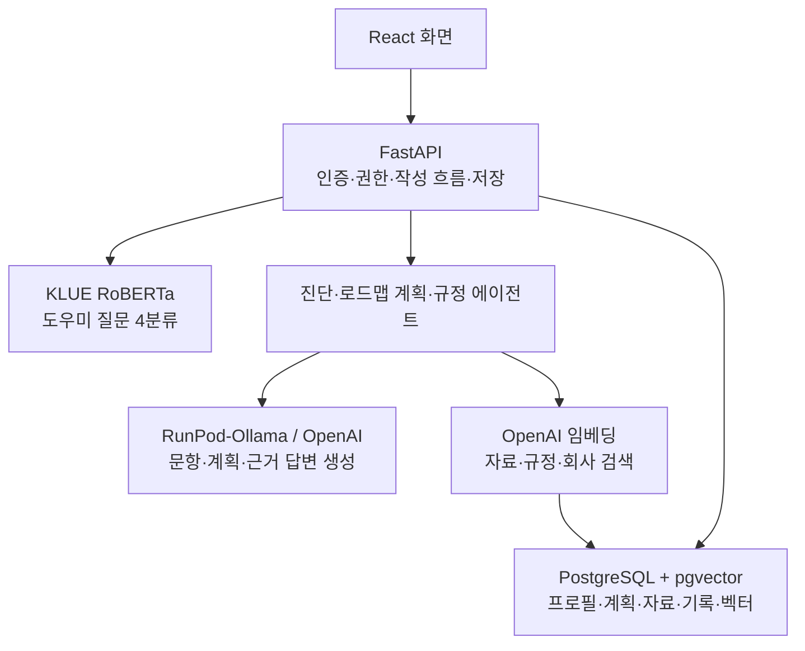

# GrowPath

**업무 목표에서 학습 계획, 실행과 돌아보기까지 이어지는 AI 역량 성장 지원 서비스**

GrowPath는 개발·운영 직군 직원이 업무에 필요한 스킬을 고르고, 실제 학습 자료로 개인 로드맵을 만들어 실행하도록 돕습니다. 사내 생활 도우미는 등록된 규정과 회사 자료를 근거로 질문에 답하고, 부서장은 확정된 팀원 계획에 피드백을 남깁니다.

[주요 기능](#2-주요-기능) · [AI와 시스템 구조](#4-ai와-시스템-구조) · [AI 에이전트](#5-ai-에이전트) · [산출물](docs/README.md) · [실행 방법](#11-개발-환경-실행)

## 1. 프로젝트 소개

| 항목 | 내용 |
| --- | --- |
| 과정 | SK네트웍스 Family AI 캠프 33기 최종 프로젝트 |
| 팀 | 2팀 **부산별빛샌드** — 송지섭(PM), 신가을(APM), 오호민, 이준희, 김영석 |
| 기간 | 2026.09.28 ~ 2026.11.20 |
| 대상 | 한국수자원공사 공개 자료와 조직을 바탕으로 한 개발·운영 직군 가상 직원 |
| 목적 | 업무 목표를 필요한 스킬과 학습 활동으로 구체화하고, 실행 기록과 사전·사후 점검으로 다음 학습 방향 정하기 |

공개 규정·학습 자료와 데모 직원 데이터를 사용하는 교육 프로젝트입니다. 실제 기관의 인사 시스템·SSO와 연동된 운영 서비스는 아닙니다.

### 역할 분담

| 팀원 | 주요 역할 |
| --- | --- |
| 송지섭(PM) | 직원·로드맵 추천 데이터 고도화, 학습 자료 추천·일정 |
| 신가을(APM) | 프로젝트 기획, 사내 규정 데이터 수집·정제·관리 |
| 오호민 | DB·벡터 검색 초기 설계, 진단·로드맵 에이전트 개발·파인튜닝 |
| 이준희 | React UI 설계·프런트엔드 개발 |
| 김영석 | 사내 생활 도우미 질문 분류, 에이전트 개발·파인튜닝 |

## 2. 주요 기능

| 기능 | 사용자가 할 수 있는 일 |
| --- | --- |
| 목표·스킬 설정 | 업무 목표를 입력하거나 추천 목표를 고르고, 기획서 요약과 본인 프로필을 바탕으로 학습할 스킬을 최대 5개 선택합니다. |
| 사전 역량 테스트 | 선택 스킬의 필수 설문·퀴즈에 응답하고, 저장된 설문 응답과 퀴즈 정오답·해설을 확인합니다. |
| 3 Course 비교 | Free·Crash·Challenge 계획과 강좌·도서를 비교하고, 자료·활동·산출물을 선택해 확정합니다. |
| 학습 실행 | 현재 주차의 활동을 확인하고 진행 상태·메모·선택 첨부를 기록합니다. 같은 로드맵의 동일 강좌는 진행 상태를 공유하고 메모·첨부는 활동별로 보존합니다. |
| 사후 점검·보고서 | 사전과 같은 설문, 같은 개념·난이도의 새 퀴즈로 돌아보고 실행 기록과 응답 변화를 보고서로 확인합니다. |
| 사내 생활 도우미 | 질문을 규정·회사·사내 생활·범위 밖으로 분류하고, 해당 자료와 공개 범위에 맞춰 답변하거나 이용 가능한 메뉴를 안내합니다. |
| 부서장·관리자 | 부서장은 확정된 소속 직원 계획을 조회하고 진행 중인 계획에 코멘트를 남깁니다. 관리자는 직원·평정·자료·규정 정보를 관리합니다. |

## 3. 학습 흐름


작성 화면은 **목표 → 세부사항·스킬 선택 → 입력 확인 → 역량 테스트 → 결과 → 로드맵·자료 → 검토·산출물·확정**의 7단계입니다. 확정한 계획은 개인 로드맵으로 저장하며 여러 계획을 함께 진행할 수 있습니다.

| Course | 작성 관점 |
| --- | --- |
| **Free** | 무료 강좌를 우선합니다. 강좌는 확인된 0원 자료를 사용하고, 도서는 유료·가격 미확인 자료도 선택할 수 있습니다. |
| **Crash** | 필요한 스킬을 학습하는 효율과 핵심 내용을 우선합니다. |
| **Challenge** | 도전적인 학습과 업무 적용을 우선합니다. |

세 Course 모두 사용자가 고정한 선택 스킬을 유지합니다.

신규 테스트에는 선택형 심화문항을 두지 않습니다. 스킬 1개는 설문 5개·퀴즈 5개, 2~5개는 스킬마다 설문 3개·퀴즈 3개입니다. 설문 변화는 자기보고이며 실제 업무 능력이나 인사평가의 확정 판정으로 사용하지 않습니다.

## 4. AI와 시스템 구조



화면이 `/api/v1`·`/api/v2`로 요청하면 FastAPI 서비스가 입력·소유자·상태를 확인하고 필요한 에이전트를 호출합니다. 결과 검증과 저장도 서비스 코드가 담당합니다.

자료 추천은 **스킬·종류·이용 조건 필터 → 목표·프로젝트·선택 스킬 맥락의 임베딩 → pgvector 검색 → 후보 검토 → 모델 추천 → 사용자 선택 → 확정 시 재검증** 순서입니다. Course별 강좌는 벡터 상위 20개에서 적용 근거를 검토합니다. 모델에 강좌는 스킬별 최대 6개, 도서는 중복을 뺀 공통 후보 최대 30권을 전달합니다. 최종 추천은 스킬별 강좌·도서 각각 최대 3개입니다. 같은 강좌나 도서를 여러 스킬에서 선택하면 자료 기간은 한 번만 계산합니다. 이 V2 자료 추천과 별도로 3 Course 생성에는 카탈로그 후보 구성과 입력량 검사를 사용합니다.

| 구성 | 현재 역할 |
| --- | --- |
| KLUE RoBERTa | 도우미 질문 4분류. 로컬 CPU 추론이며 모델 파일·manifest를 별도로 준비합니다. |
| 팀 파인튜닝 27B · Q4_K_M | 목표·스킬·문항·로드맵 등 학습 계획 생성. Ollama 이름은 `growpath-27b`입니다. |
| 팀 파인튜닝 4B · BF16 | 규정·회사 답변과 지원 조건 해석. Ollama 이름은 `growpath-regulation-4b`이며 추론 모드는 항상 끕니다. |
| OpenAI 생성 모드 | 화면에서 선택할 수 있는 대체 생성 경로. 사용할 모델은 서버 설정으로 지정합니다. |
| `text-embedding-3-small` | 생성 모드와 공통으로 사용하는 1,536차원 검색 임베딩입니다. RunPod 모드도 검색에는 OpenAI 키가 필요합니다. |

[분류 모델 연결](backend/classification.md) · [27B 모델 안내](backend/models/fine_tunning/README.md) · [RunPod 연결·27B/4B 모델 준비](backend/RunPod_Ollama_연결_절차.md)

## 5. AI 에이전트

| 에이전트 | 하는 일 |
| --- | --- |
| 진단 | 직원 프로필에서 목표 후보를 제안하고, 기획서를 요약해 목표에 맞는 스킬을 추천합니다. 선택한 스킬의 점검 문항을 만들고, 사전·사후 응답과 실행 기록으로 보고서의 피드백을 작성합니다. |
| 로드맵 계획 | 같은 목표와 확정 스킬을 바탕으로 Free·Crash·Challenge 세 안을 작성합니다. 검색된 강좌·도서 후보에서 학습 자료를 추천하고, 실습 활동과 산출물을 제안합니다. |
| 규정 | 사내 생활 도우미에서 질문 유형에 따라 규정·회사 자료를 근거로 답변하거나 사내 메뉴를 안내합니다. 로드맵별 학습 지원 조건도 확인합니다. |

## 6. 데이터와 저장

공개 규정, 외부 강좌·도서·자격 자료, 스킬 매핑, 회사 정보와 가상 사내 생활 안내를 사용합니다. 데모 직원 프로필과 본인 입력은 목표·스킬 추천의 맥락으로 연결하고, 평정은 본인이 활용에 동의한 범위에서만 목표 추천에 참조합니다.

PostgreSQL은 프로필·초안·확정 계획·버전·자료 선택·활동·점검·보고서·코멘트를 저장하고, pgvector는 자료·규정·회사 검색 벡터를 저장합니다. 별도 GraphDB는 사용하지 않습니다.

DB 백업·규정 원문·모델 가중치는 저장소 밖에서 전달합니다. 백업은 **함께 전달된 manifest의 크기·SHA-256**으로 확인합니다. 저장소에 추적된 과거 manifest를 최신 공유본의 해시로 대신 사용하지 않습니다.

[DB 코드와 검사](database/README.md) · [백업·규정 원문 준비](team_db/README.md) · [복원 상세와 이전 이력](database/RESTORE.md)

## 7. 역할과 공개 범위

| 역할 | 공개·수정 범위 |
| --- | --- |
| 직원 | 본인의 입력·초안·계획·활동·점검·보고서를 작성하고 조회합니다. |
| 같은 기관·부서의 부서장 | 직원이 **확정한 계획부터** 조회하고 학습 진행 중에 코멘트를 작성합니다. 마침·보관 계획은 읽기 전용입니다. |
| 시스템 관리자 | 직원·조직·평정·학습 자료·규정 데이터를 관리합니다. 관리자 데이터 운영 권한과 개인 학습 원본 열람 권한은 구분합니다. |

미확정 초안과 개인 설문·퀴즈 원본, 메모·첨부·평정 등은 부서장에게 공개하지 않습니다. 부서장 코멘트가 확정 계획을 자동 변경하지 않으며, 직원이 수정안을 검토·확정해야 반영됩니다.

## 8. 기술 스택과 저장소

| 영역 | 구성 |
| --- | --- |
| 화면 | React 19 · TypeScript · Vite · React Router · TanStack Query · Zustand |
| API·서비스 | Python 3.12 · FastAPI · SQLAlchemy · psycopg |
| 데이터·검색 | PostgreSQL 17 · pgvector |
| AI | Transformers · PyTorch CPU · RunPod-Ollama · OpenAI |
| 실행 | Docker Compose · nginx |
| 검사 | Vitest · ESLint · TypeScript · Python unittest · GitHub Actions |

```text
frontend/          사용자·부서장·관리자 화면, API 연결, 비교용 테마
backend/           참고 FastAPI 백엔드, AI 역할, 저장·권한 서비스
└── models/        질문 분류 실행 파일·실험 자료, 27B 모델 안내
database/          DB 코드·마이그레이션·전처리·검색·복원 도구
team_db/           외부 백업·규정 원문을 넣는 위치와 준비 안내
docs/              기획·설계·데이터·모델 산출물과 파일 manifest
scripts/           빈 DB의 최초 백업 복원 스크립트
docker-compose.yml DB·초기 준비·API·화면 실행 구성
```

현재 화면에는 templatemo·Tooplate 기반 **비교용 테마 22종**이 연결돼 있습니다. 기본값은 `tm464`·상단 메뉴·넓은 본문이며, 화면의 테마 선택 도구에서 메뉴 위치와 본문 폭을 바꿀 수 있습니다. 테마별 원본 출처는 `frontend/src/skins/<id>/index.ts`에 기록합니다.

## 9. 산출물

[산출물 목록](docs/README.md)에서 요구사항·WBS·기획서·화면설계·수집/전처리·DB/벡터DB·모델·아키텍처 문서를 확인할 수 있습니다. [파일 manifest](docs/artifacts.manifest.json)는 반영 파일의 상대 경로·크기·SHA-256과 원본 링크를 연결합니다.

README의 설명 기준은 **2026-11-04 main [`f8c2799`](https://github.com/20260528-skn-family-ai-33/SKN33-Final-2Team/tree/f8c27996dcc91b7dce9ac913dd79edb78b48a986)**입니다. PR57·61의 학습 흐름, PR60의 비교 테마, PR66의 자료 추천과 공유 일정 보정, PR70의 로드맵 생성 안정화를 포함합니다. 산출물 본문은 **2026-11-03 main `80cc597` 기준 검토본**이며, WBS와 요구사항 정의서의 담당자는 11월 4일에 갱신했습니다. 화면설계서의 71개 그림은 2026-10-28 main `438b011` 당시 캡처입니다. 공식 제출 현황은 [산출물 관리 시트 2팀 탭](https://docs.google.com/spreadsheets/d/1EQeYN_FpKWzzxHUdtjG9WYaP9t43bvf-H5e1jGMTMEM/edit?gid=1029234216)을 따릅니다.

## 10. 개발과 검증

프런트엔드는 `frontend/`에서 다음 검사를 실행합니다. [GitHub Actions](.github/workflows/frontend-ci.yml)도 같은 순서로 검사합니다.

```bash
npm run typecheck
npm run lint
npm test
npm run build
```

백엔드는 `backend/`에서 `python -m unittest discover -s tests -v`를 사용합니다. DB 준비·복원 상태에 따라 필요한 검사가 달라지므로 [백엔드 안내](backend/README.md)와 [DB 검사 안내](database/README.md)를 함께 확인합니다. 화면 흐름·실제 모델 품질·동시 사용자 검증은 단위 검사와 별도로 수행합니다.

일정·WBS는 [팀 Notion](https://app.notion.com/p/ohgiraffers/SKN33_FINAL_2-_-3e9649136c1180f6b847e176dd888c98), 개발 작업은 GitHub Issues, 변경과 검증은 PR에서 관리합니다. 브랜치·커밋 형식 등 협업 규칙은 [AGENTS.md](AGENTS.md)를 따릅니다.

## 11. 개발 환경 실행

Docker Desktop과 Compose v2를 준비합니다. 로컬에서 화면을 개발할 때는 Node.js 20.19 이상(24 권장), Python 직접 실행은 3.12를 사용합니다.

1. 저장소 루트의 `.env.example`을 `.env`로 복사하고 `GP5_DB_PASSWORD`·`GP5_DEMO_PASSWORD`를 설정합니다.
2. 팀 백업 `growpath_latest.dump`와 동반 manifest를 받아 해시를 확인한 뒤 `team_db/`에 두고, 규정 PDF를 `team_db/regulations/`에 준비합니다.
3. [분류 모델 파일](backend/classification.md)을 `backend/models/`에 준비합니다. 생성에는 [RunPod-Ollama 연결](backend/RunPod_Ollama_연결_절차.md) 또는 OpenAI 설정이 필요하며, 공통 검색용 `OPENAI_API_KEY`도 설정합니다. 키·비밀번호는 저장소에 넣지 않습니다.
4. 저장소 루트에서 실행합니다.

```bash
docker compose up -d --build
```

| 주소 | 용도 |
| --- | --- |
| <http://localhost:8816> | React 서비스 화면 |
| <http://localhost:8815/api/docs> | FastAPI 문서 |

Compose는 **DB → 빈 DB의 백업 복원 → 보충 자료·보조 스키마 준비 → API → 화면** 순서로 실행합니다. 이미 데이터가 있으면 최초 백업 복원은 건너뜁니다. `docker compose down`으로 종료하며 DB와 업로드 파일은 볼륨에 남습니다.

### 베타 설치·시연 설정 (#63, #64)

Windows·macOS·Linux 모두 Docker Engine/Desktop과 Compose v2가 필요합니다. macOS·Linux에서는 저장소 루트에서 `cp .env.example .env`로 복사한 뒤 위 1~4번을 진행하세요. Windows에서는 `Copy-Item .env.example .env`를 사용합니다. 기존 `.env`는 덮어쓰지 마세요.

OpenAI가 직원의 기본 AI입니다. 실제 생성 전에 `.env`의 `OPENAI_API_KEY`에 유효한 키를 입력하세요. 예시 파일은 빈 값이며 키가 없으면 OpenAI는 사용 불가로 표시됩니다. 이전 예시의 `sk-example-not-a-real-key`를 복사했다면 지우세요. 값을 바꾼 뒤 `docker compose up -d --build`로 반영합니다.

`GP5_DEMO_MODE=off`에서는 직원 목록(`/demo/accounts`), 시연 초기화(`/demo/reset`), 단계 이동(`/demo/jump`), 시연 설정(`/me/demo-settings`) API가 404를 반환합니다. 직원 고르기는 숨겨지고 사번 직접 입력은 유지됩니다. 외부 베타는 예시 파일의 `off`를 유지하세요. 설정을 생략하면 기존 시연 호환을 위해 `on`입니다.

키 없이 로컬 시연할 때만 `GP5_DEMO_MODE=on`으로 켜고 화면 시연 도구의 ‘가데이터로 보기’를 사용하세요. 프런트 시연 도구 표시는 기존 `VITE_DEMO_TOOLS` 설정을 따릅니다. 비밀번호는 API·화면·직원 엑셀 안내문으로 배포하지 않으며 관리자가 별도로 전달합니다. 직원별 초기 비밀번호와 첫 로그인 변경은 별도 후속 범위입니다.

이번 베타에서는 제출본 전용 `setup.ps1`·`scripts/fetch_model.py`·`model-fetch` 반영을 제외했습니다. 분류 모델과 DB 백업은 위 안내대로 별도 준비해야 합니다.

### AI 연결 설정

저장소 루트의 [`.env.example`](.env.example)을 기준으로 `.env`를 작성합니다. Pod 생성·인증키 설정·두 팀 모델 준비는 [RunPod 연결 절차](backend/RunPod_Ollama_연결_절차.md)를 따릅니다.

| 설정 | 용도 |
| --- | --- |
| `OLLAMA_BASE_URL` · `OLLAMA_API_KEY` | RunPod-Ollama 서버 주소와 인증키입니다. |
| `OLLAMA_MODEL` · `OLLAMA_MODEL_REGULATION` | 비워 두면 각각 `growpath-27b`(진단·로드맵), `growpath-regulation-4b`(규정)를 사용합니다. Pod에서 준비한 Ollama 모델 이름을 사용합니다. |
| `OLLAMA_THINK` | 예시값은 `off`입니다. 27B는 사용자 선택이 우선하며, 이 값을 비우면 모델 기본값을 따릅니다. 규정 4B의 Ollama 호출은 이 설정과 관계없이 생각 모드를 끕니다. |
| `OPENAI_API_KEY` | OpenAI 생성과 공통 검색 임베딩에 사용합니다. RunPod-Ollama 모드에서도 검색용으로 필요합니다. |
| `OPENAI_MODEL` | OpenAI 생성 모드에서 사용할 모델입니다. 서버 설정으로 지정합니다. |
| `OPENAI_EMBED_MODEL` | 팀 DB 벡터와 같은 `text-embedding-3-small`(1,536차원)을 사용합니다. |

### Python 직접 실행

Python 3.12 가상환경을 준비한 뒤 저장소 루트에서 백엔드·DB 도구용 의존성을 설치합니다. Docker로 실행할 때는 이미지 빌드 중 설치됩니다.

```bash
pip install -r requirements.txt
python backend/tools/install_catalog_tokenizer.py
```

토크나이저 준비와 오프라인 설치, 백엔드 직접 실행 방법은 [백엔드 안내](backend/README.md)를 따릅니다. `backend/`에서 루트의 `.env`를 읽으려면 `GP5_ENV_FILE=../.env`를 지정합니다.

### 화면 직접 실행

화면을 직접 개발할 때는 `docker compose up -d backend`로 API·DB를 준비한 뒤 아래 명령을 사용합니다. 개발 화면은 <http://localhost:5185>이며 `/api`는 설정한 백엔드로 전달됩니다.

```bash
npm ci --prefix frontend
npm run dev --prefix frontend
```

[프런트엔드 실행](frontend/README.md) · [백엔드 실행·설정](backend/README.md) · [전체 의존성](requirements.txt)
