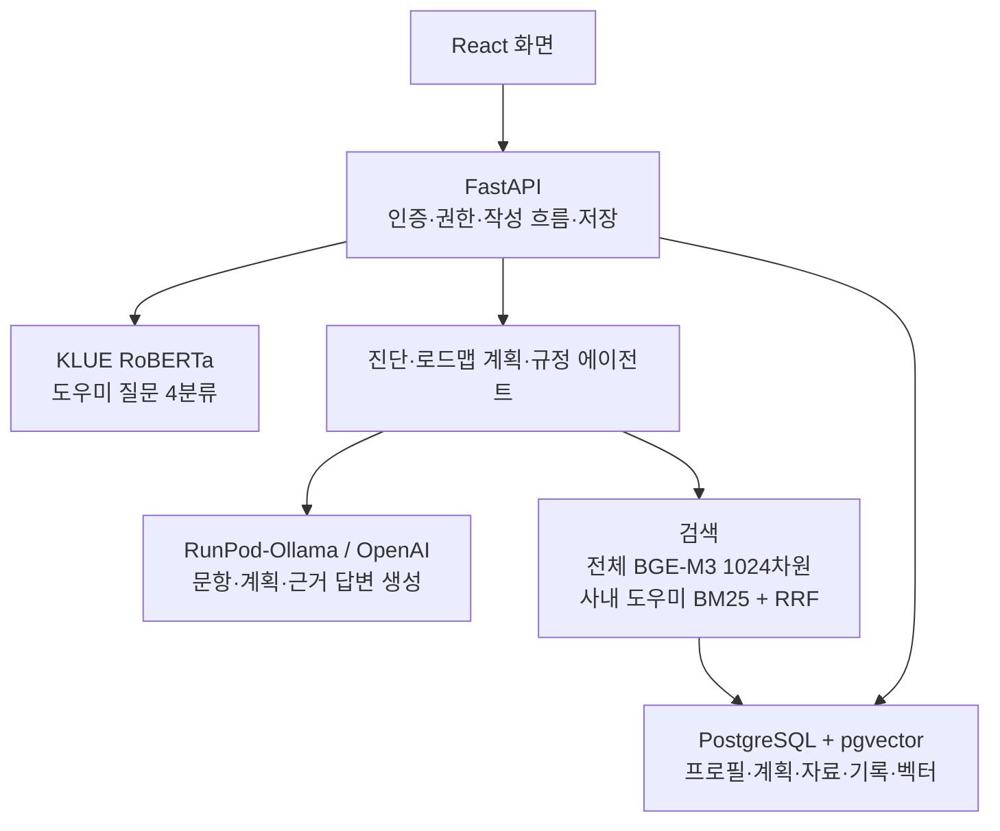

# GrowPath

**업무 목표에서 학습 계획, 실행과 돌아보기까지 이어지는 AI 역량 성장 지원 서비스**

GrowPath는 개발·운영 직군 직원이 업무에 필요한 스킬을 고르고, 실제 학습 자료로 개인 로드맵을 만들어 실행하도록 돕습니다. 사내 생활 도우미는 등록된 규정과 회사 자료를 근거로 질문에 답하고, 부서장은 확정된 팀원 계획에 피드백을 남깁니다.

[주요 기능](#2-주요-기능) · [AI와 시스템 구조](#4-ai와-시스템-구조) · [AI 에이전트](#5-ai-에이전트) · [산출물](docs/README.md) · [실행 방법](#11-개발-환경-실행)

## 1. 프로젝트 소개

| 항목 | 내용 |
| --- | --- |
| 과정 | SK네트웍스 Family AI 캠프 33기 최종 프로젝트 |
| 팀 | 2팀 **부산별빛샌드** — 송지섭(PM), 신가을(APM), 오호민, 이준희, 김영석 |
| 기간 | 2026.09.28 ~ 2026.11.20 |
| 대상 | 한국수자원공사 공개 자료와 조직을 바탕으로 한 개발·운영 직군 가상 직원 |
| 목적 | 업무 목표를 필요한 스킬과 학습 활동으로 구체화하고, 실행 기록과 사전·사후 점검으로 다음 학습 방향 정하기 |

공개 규정·학습 자료와 데모 직원 데이터를 사용하는 교육 프로젝트입니다. 실제 기관의 인사 시스템·SSO와 연동된 운영 서비스는 아닙니다.

### 역할 분담

| 팀원 | 주요 역할 |
| --- | --- |
| 송지섭(PM) | 직원·로드맵 추천 데이터 고도화, 학습 자료 추천·일정 |
| 신가을(APM) | 프로젝트 기획, 사내 규정 데이터 수집·정제·관리 |
| 오호민 | DB·벡터 검색 초기 설계, 진단·로드맵 에이전트 개발·파인튜닝 |
| 이준희 | React UI 설계·프런트엔드 개발 |
| 김영석 | 사내 생활 도우미 질문 분류, 에이전트 개발·파인튜닝 |

## 2. 주요 기능

| 기능 | 사용자가 할 수 있는 일 |
| --- | --- |
| 목표·스킬 설정 | 업무 목표를 입력하거나 추천 목표를 고르고, 기획서 요약과 본인 프로필을 바탕으로 학습할 스킬을 최대 3개 선택합니다. |
| 사전 역량 테스트 | 선택 스킬의 필수 설문·퀴즈에 응답하고, 저장된 설문 응답과 퀴즈 정오답·해설을 확인합니다. |
| 3 Course 비교 | Free·Crash·Challenge 계획과 강좌·도서를 비교하고, 자료·활동·산출물을 선택해 확정합니다. |
| 학습 실행 | 현재 주차의 활동을 확인하고 진행 상태·메모·선택 첨부를 기록합니다. 같은 로드맵의 동일 강좌는 진행 상태를 공유하고 메모·첨부는 활동별로 보존합니다. |
| 사후 점검·보고서 | 사전과 같은 설문, 같은 개념·난이도의 새 퀴즈로 돌아보고 실행 기록과 응답 변화를 보고서로 확인합니다. |
| 사내 생활 도우미 | 질문을 규정·회사·사내 생활·범위 밖으로 분류하고, 해당 자료와 공개 범위에 맞춰 답변하거나 이용 가능한 메뉴를 안내합니다. |
| 부서장·관리자 | 부서장은 확정된 소속 직원 계획을 조회하고 진행 중인 계획에 코멘트를 남깁니다. 관리자는 직원·자료·규정 정보를 관리합니다. |

## 3. 학습 흐름


작성 화면은 **목표 → 세부사항·스킬 선택 → 입력 확인 → 역량 테스트 → 결과 → 로드맵·자료 → 검토·산출물·확정**의 7단계입니다. 확정한 계획은 개인 로드맵으로 저장하며 여러 계획을 함께 진행할 수 있습니다.

| Course | 작성 관점 |
| --- | --- |
| **Free** | 무료 강좌를 우선합니다. 강좌는 확인된 0원 자료를 사용하고, 도서는 유료·가격 미확인 자료도 선택할 수 있습니다. |
| **Crash** | 필요한 스킬을 학습하는 효율과 핵심 내용을 우선합니다. |
| **Challenge** | 도전적인 학습과 업무 적용을 우선합니다. |

세 Course 모두 사용자가 고정한 선택 스킬을 유지합니다.

신규 테스트에는 선택형 심화문항을 두지 않습니다. 스킬 1개는 설문 5개·퀴즈 5개, 2~3개는 스킬마다 설문 3개·퀴즈 3개입니다. 설문 변화는 자기보고이며 실제 업무 능력이나 인사평가의 확정 판정으로 사용하지 않습니다.

## 4. AI와 시스템 구조



화면이 `/api/v1`·`/api/v2`로 요청하면 FastAPI 서비스가 입력·소유자·상태를 확인하고 필요한 에이전트를 호출합니다. 결과 검증과 저장도 서비스 코드가 담당합니다.

자료 추천은 **스킬·종류·이용 조건 필터 → 목표·프로젝트·선택 스킬 맥락의 임베딩 → pgvector 검색 → 후보 검토 → 모델 추천 → 사용자 선택 → 확정 시 재검증** 순서입니다. Course별 강좌는 벡터 상위 20개에서 적용 근거를 검토합니다. 모델에 강좌는 스킬별 최대 6개, 도서는 중복을 뺀 공통 후보 최대 30권을 전달합니다. 최종 추천은 스킬별 강좌·도서 각각 최대 3개입니다. 같은 강좌나 도서를 여러 스킬에서 선택하면 자료 기간은 한 번만 계산합니다. 이 V2 자료 추천과 별도로 3 Course 생성에는 카탈로그 후보 구성과 입력량 검사를 사용합니다.

| 구성 | 현재 역할 |
| --- | --- |
| KLUE RoBERTa | 도우미 질문 4분류. 로컬 CPU 추론이며 모델 파일·manifest를 별도로 준비합니다. |
| 팀 파인튜닝 27B · Q4_K_M | 목표·스킬·문항·로드맵 등 학습 계획 생성. Ollama 이름은 `growpath-27b`입니다. |
| 팀 파인튜닝 4B · BF16 | 규정·회사 질문 답변. Ollama 이름은 `growpath-regulation-4b`이며 추론 모드는 항상 끕니다. |
| OpenAI 생성 모드 | 화면에서 선택할 수 있는 대체 생성 경로. 사용할 모델은 서버 설정으로 지정합니다. |
| `BAAI/bge-m3` | 규정·회사 정보·사내 생활·강좌·도서 등 전체 검색용 1,024차원 모델입니다. 공식 고정 revision의 CPU 서버에서 기본 FP32 추론·CLS·FP32 L2 정규화로 질문을 임베딩합니다. |

[분류 모델 연결](backend/classification.md) · [27B 모델 안내](backend/models/fine_tunning/README.md) · [RunPod 연결·27B/4B 모델 준비](backend/RunPod_Ollama_연결_절차.md)

현재 설치·DB 연결은 [공유 BGE-M3 DB 연결](backend/README.md#공유-bge-m3-db-연결-124)을 따릅니다. #124 공유 백업을 별도 `growpath_bge_m3`에 복원하고 4,832개 벡터를 재사용합니다. 생성 LLM은 기존 선택을 유지합니다.

사내 도우미는 **BM25 + BGE-M3 pgvector → RRF → 같은 부모 조항 문맥 보충**, 학습 자료 추천은 기존 가격·스킬·코스 범위를 유지한 BGE-M3 pgvector 검색을 사용합니다. 기존 벡터를 재생성하지 않습니다.

## 5. AI 에이전트

| 에이전트 | 하는 일 |
| --- | --- |
| 진단 | 직원 프로필에서 목표 후보를 제안하고, 기획서를 요약해 목표에 맞는 스킬을 추천합니다. 선택한 스킬의 점검 문항을 만들고, 사전·사후 응답과 실행 기록으로 보고서의 피드백을 작성합니다. |
| 로드맵 계획 | 같은 목표와 확정 스킬을 바탕으로 Free·Crash·Challenge 세 안을 작성합니다. 검색된 강좌·도서 후보에서 학습 자료를 추천하고, 실습 활동과 산출물을 제안합니다. |
| 규정 | 사내 생활 도우미에서 질문 유형에 따라 규정·회사 자료를 근거로 답변하거나 사내 메뉴를 안내합니다. 로드맵 3안 생성 화면에서는 교육비 규정 원문을 초안당 한 번 조회합니다. 교육비 지원 대상과 예산은 교육담당자에게 확인합니다. |

## 6. 데이터와 저장

공개 규정, 외부 강좌·도서·자격 자료, 스킬 매핑, 회사 정보와 가상 사내 생활 안내를 사용합니다. 데모 직원 프로필과 본인 입력은 목표·스킬 추천의 맥락으로 연결합니다.

PostgreSQL은 프로필·초안·확정 계획·버전·자료 선택·활동·점검·보고서·코멘트를 저장하고, pgvector는 자료·규정·회사 검색 벡터를 저장합니다. 별도 GraphDB는 사용하지 않습니다.

DB 백업·규정 원문·모델 가중치는 저장소 밖에서 전달합니다. 백업은 **함께 전달된 manifest의 크기·SHA-256**으로 확인합니다. 저장소에 추적된 과거 manifest를 최신 공유본의 해시로 대신 사용하지 않습니다.

[DB 코드와 검사](database/README.md) · [백업·규정 원문 준비](team_db/README.md) · [복원 상세와 이전 이력](database/RESTORE.md)

## 7. 역할과 공개 범위

| 역할 | 공개·수정 범위 |
| --- | --- |
| 직원 | 본인의 입력·초안·계획·활동·점검·보고서를 작성하고 조회합니다. |
| 같은 기관·부서의 부서장 | 직원이 **확정한 계획부터** 조회하고 학습 진행 중에 코멘트를 작성합니다. 마침·보관 계획은 읽기 전용입니다. |
| 시스템 관리자 | 직원·조직·학습 자료·규정 데이터를 관리합니다. 관리자 데이터 운영 권한과 개인 학습 원본 열람 권한은 구분합니다. |

미확정 초안과 개인 설문·퀴즈 원본, 메모·첨부·평정 등은 부서장에게 공개하지 않습니다. 부서장 코멘트가 확정 계획을 자동 변경하지 않으며, 직원이 수정안을 검토·확정해야 반영됩니다.

## 8. 기술 스택과 저장소

| 영역 | 구성 |
| --- | --- |
| 화면 | React 19 · TypeScript · Vite · React Router · TanStack Query · Zustand |
| API·서비스 | Python 3.12 · FastAPI · SQLAlchemy · psycopg |
| 데이터·검색 | PostgreSQL 17 · pgvector |
| AI | Transformers · PyTorch CPU · RunPod-Ollama · OpenAI |
| 실행 | Docker Compose · nginx |
| 검사 | Vitest · ESLint · TypeScript · Python unittest · GitHub Actions |

```text
frontend/          사용자·부서장·관리자 화면, API 연결, 비교용 테마
backend/           참고 FastAPI 백엔드, AI 역할, 저장·권한 서비스
└── models/        질문 분류 실행 파일·실험 자료, 27B 모델 안내
database/          DB 코드·마이그레이션·전처리·검색·복원 도구
team_db/           외부 백업·규정 원문을 넣는 위치와 준비 안내
docs/              기획·설계·데이터·모델 산출물과 파일 manifest
scripts/           빈 DB의 최초 백업 복원 스크립트
docker-compose.yml DB·초기 준비·API·화면 실행 구성
```

현재 화면에는 templatemo 기반 **비교용 테마 7종**(464 Ultra Profile·486 New Event·503 Newline·557 Grad School·590 Topic Listing·606 String Master·612 Parallax Starter)이 연결돼 있습니다. 기본값은 `tm612`(612 Parallax Starter)·상단 메뉴·넓은 본문이며(브라우저에는 직접 고르거나 `?skin=`으로 연 값만 기억합니다), 화면 왼쪽 아래의 테마 선택 도구(접힌 채 시작)를 펼쳐 테마·메뉴 위치·본문 폭을 바꿀 수 있습니다(로그인 화면에서는 테마만). 테마별 원본 출처는 `frontend/src/skins/<id>/index.ts`에 기록합니다.

## 9. 산출물

[산출물 목록](docs/README.md)에서 요구사항·WBS·기획서·화면설계·수집/전처리·DB/벡터DB·모델·아키텍처 문서를 확인할 수 있습니다. [파일 manifest](docs/artifacts.manifest.json)는 반영 파일의 상대 경로·크기·SHA-256과 원본 링크를 연결합니다.

README의 설명 기준은 **2026-11-04 main [`f8c2799`](https://github.com/20260528-skn-family-ai-33/SKN33-Final-2Team/tree/f8c27996dcc91b7dce9ac913dd79edb78b48a986)**입니다. PR57·61의 학습 흐름, PR60의 비교 테마, PR66의 자료 추천과 공유 일정 보정, PR70의 로드맵 생성 안정화를 포함합니다. 산출물 본문은 **2026-11-03 main `80cc597` 기준 검토본**이며, WBS와 요구사항 정의서의 담당자는 11월 4일에 갱신했습니다. 화면설계서의 71개 그림은 2026-10-28 main `438b011` 당시 캡처입니다. 공식 제출 현황은 [산출물 관리 시트 2팀 탭](https://docs.google.com/spreadsheets/d/1EQeYN_FpKWzzxHUdtjG9WYaP9t43bvf-H5e1jGMTMEM/edit?gid=1029234216)을 따릅니다.

## 10. 개발과 검증

프런트엔드는 `frontend/`에서 다음 검사를 실행합니다. [GitHub Actions](.github/workflows/frontend-ci.yml)도 같은 순서로 검사합니다.

```bash
npm run typecheck
npm run lint
npm test
npm run build
```

백엔드는 `backend/`에서 `python -m unittest discover -s tests -v`를 사용합니다. DB 준비·복원 상태에 따라 필요한 검사가 달라지므로 [백엔드 안내](backend/README.md)와 [DB 검사 안내](database/README.md)를 함께 확인합니다. 화면 흐름·실제 모델 품질·동시 사용자 검증은 단위 검사와 별도로 수행합니다.

일정·WBS는 [팀 Notion](https://app.notion.com/p/ohgiraffers/SKN33_FINAL_2-_-3e9649136c1180f6b847e176dd888c98), 개발 작업은 GitHub Issues, 변경과 검증은 PR에서 관리합니다. 브랜치·커밋 형식 등 협업 규칙은 [AGENTS.md](AGENTS.md)를 따릅니다.

### 프로젝트 버전과 배포 기록

베타 프로젝트 버전은 루트 [VERSION](VERSION)의 `0.2.0`부터 관리합니다. 앞에 `v`나 접미사를 붙이지 않은 숫자 세 자리 `X.Y.Z`만 저장하며 각 숫자의 앞자리 0은 허용하지 않습니다. 파일 누락·잘못된 형식은 빌드 또는 백엔드 시작 시 오류로 처리합니다.

- 화면은 빌드 때 VERSION을 읽어 로그인 화면과 직원·부서장·관리자 메뉴 하단에 `GrowPath v버전 · Beta`를 표시합니다. `Beta`는 현재 서비스 단계 표시입니다.
- 백엔드는 시작 때 같은 파일을 읽어 API 문서의 버전으로 제공합니다. `/api/v1`의 계약 경로나 직원 로드맵의 버전 번호와는 별개입니다.
- 프런트는 private 패키지이므로 `package.json`·잠금 파일에 프로젝트 버전을 중복 저장하지 않습니다. VERSION을 바꾸면 개발 서버·백엔드를 재시작하고 배포 이미지를 다시 빌드해야 합니다.
- 배포 단위로 번호를 올립니다. 베타 중 버그 수정은 `0.2.1`, 기능 추가는 `0.3.0`처럼 관리하고, 호환성을 깨는 변경은 영향과 이관 방법을 PR에 남깁니다. 정식 `1.0.0` 전환은 팀이 별도로 결정합니다.
- 배포할 변경을 PR로 검토·병합한 뒤 해당 커밋에 VERSION과 같은 이름의 Git 태그(예: `v0.2.0`)를 연결하고 GitHub Release에 변경·검증·알려진 제약을 기록합니다. 태그 게시와 배포는 별도 승인 범위이며 이미 배포한 태그를 다른 커밋으로 옮기지 않습니다.

Docker Compose는 VERSION을 프런트 빌드와 백엔드 이미지에 함께 넣습니다. 프런트 단독 Docker 빌드도 저장소 루트에서 `docker build -f frontend/Dockerfile -t growpath-web .`로 실행합니다. `frontend/`나 `backend/`만 따로 복사할 때는 루트 VERSION이 빠지지 않게 전체 저장소 구조를 유지해야 합니다.

## 11. 개발 환경 실행

Docker Desktop과 Compose v2를 준비합니다. 로컬에서 화면을 개발할 때는 Node.js 20.19 이상(24 권장), Python 직접 실행은 3.12를 사용합니다.

아래 1~4번은 최초 설치 절차입니다. 이미 설치한 환경의 코드·설정을 바꿀 때는 [기존 설치의 설정 변경과 업데이트](#기존-설치의-설정-변경과-업데이트)를 따르세요.

1. 저장소 루트의 `.env.example`을 `.env`로 복사하고 DB용 `GP5_DB_PASSWORD`를 설정합니다. 복원된 직원·관리자는 기존 비밀번호를 사용합니다. 관리자 화면에서 새 직원을 추가할 때만 `GP5_DEMO_PASSWORD`를 별도로 설정합니다.
2. #124의 `growpath_bge_m3_embedding.dump`와 동반 manifest를 `team_db/`에 두고, 아래 명령으로 별도 DB에 복원합니다. 기존 OpenAI DB는 보존합니다. 규정 PDF는 `team_db/regulations/`에 준비합니다.
3. [분류 모델 파일](backend/classification.md)과 [공식 BGE 가중치](backend/README.md#공유-bge-m3-db-연결-124)를 준비합니다. 생성에는 기존 RunPod-Ollama 또는 OpenAI 설정을 사용합니다. BGE 검색에는 OpenAI 키가 필요하지 않습니다.
4. 저장소 루트에서 실행합니다(복원 도구는 PowerShell).

```powershell
docker compose up -d --wait db
./scripts/restore-bge-db.ps1 -Apply
docker compose up -d --build --wait --wait-timeout 180
docker compose exec backend python tools/verify_bge_database.py --server
```

| 주소 | 용도 |
| --- | --- |
| <http://localhost:8816> | React 서비스 화면 |
| <http://localhost:8815/api/docs> | FastAPI 문서 |

Compose는 **DB → 복원된 BGE DB 읽기 전용 검사·BGE 서버 준비 → API → 화면** 순서로 실행합니다. 복원은 별도 명령이며 동일 백업 재실행은 건너뜁니다. 공유 DB에는 기존 OpenAI 보충·비밀번호 초기화 도구를 실행하지 않습니다. `docker compose down`은 DB·업로드 볼륨을 보존합니다. 이미 복원한 PC에서 새 공유본으로 바꿀 때는 [새 공유본으로 교체](team_db/README.md#새-공유본으로-교체) 절차를 따릅니다.

복원한 직원 계정은 **기존 비밀번호**로 로그인합니다. 비밀번호는 백업 제공자·관리자에게 별도로 전달받으세요. 설치기는 직원 비밀번호 해시를 기본으로 보존하며, `GP5_DEMO_PASSWORD`를 설정하거나 설치기를 다시 실행해도 기존 직원 비밀번호를 바꾸지 않습니다. 해시가 NULL이거나 잘못된 형식이어도 임의로 초기화하지 않습니다.

베타 점검자는 백업 제공자 또는 서비스 관리자에게 시험용 직원 사번과 관리자 아이디, 각 계정의 비밀번호를 비공개로 전달받습니다. 두 계정은 각각 새 브라우저 세션에서 로그인하고, 새로고침 후 같은 역할로 접속되는지와 로그아웃 뒤 `GET /api/v1/me`가 401인지 확인합니다. 로그인 실패 시 계정 종류·아이디·활성 상태부터 확인합니다. 기존 비밀번호를 전달받을 수 없으면 DB 관리 권한자에게 해당 계정만 재설정하도록 요청하고 같은 순서로 재검증합니다. 이슈에는 역할과 검증 결과만 기록합니다.

### BGE 설치기의 계정 보존

`tools/setup_db.py`와 Compose의 `backend-setup`은 복원된 BGE DB를 읽기 전용으로 검사합니다. 관리자 생성·직원 비밀번호 초기화·보충 자료 적재를 자동 실행하지 않습니다. 이전 설치기의 `--reset-team-passwords`, `--keep-team-passwords`, `--supplement-only` 옵션은 DB 검사 전에 오류로 거절합니다. 계정 변경이 필요하면 관리자에게 별도로 요청하고, 이전 설치기를 공유 BGE DB에 실행하지 마세요.

### 베타 설치·시연 설정 (#63, #64)

Windows·macOS·Linux 모두 Docker Engine/Desktop과 Compose v2가 필요합니다. macOS·Linux에서는 저장소 루트에서 `cp .env.example .env`로 복사한 뒤 위 1~4번을 진행하세요. Windows에서는 `Copy-Item .env.example .env`를 사용합니다. 기존 `.env`는 덮어쓰지 마세요.

위 복원 스크립트는 PowerShell이 필요합니다. PowerShell을 사용하지 않는 환경은 [공유 DB 수동 복원 안내](backend/README.md#공유-파일과-복원)를 따릅니다.

직원이 아직 AI를 선택하지 않았다면 생성 모델의 기본값은 **RunPod-Ollama(`ollama`)**입니다. 기존 선택은 유지합니다. OpenAI 키는 OpenAI 생성 모드에만 필요하며, 전체 검색은 별도 BGE-M3를 사용합니다. 키·설정 변경은 아래 앱 재생성 절차로 반영합니다.

베타 동안은 루트 `.env`의 **`GP5_BETA_ACCOUNT_PICKER=on`**으로 로그인 화면의 DB 직원 고르기를 유지합니다. 기존 `.env`를 쓰는 경우 이 값을 추가하세요. 로그인 전 이름·사번·부서·부서장 여부가 표시되며, 선택하면 사번만 채워지고 비밀번호는 직접 입력합니다. 이 설정은 가데이터·시연 도구와 독립적이며 미설정 기본값은 `off`입니다.

**베타 종료 시** `GP5_BETA_ACCOUNT_PICKER=off`로 바꾼 뒤 `docker compose up -d --no-deps --force-recreate backend`를 실행하고, `docker compose restart frontend`로 nginx가 새 백엔드 주소를 읽게 하세요. 로그인 화면을 새로고침하면 `/demo/accounts`가 DB 조회 전에 404를 반환하고 직원 고르기가 사라집니다. 사번 직접 입력 로그인은 유지합니다. 화면 재빌드는 필요하지 않으며 베타 종료 날짜·버전을 코드에서 임의로 판단하지 않습니다.

시연 기본값은 서버·Compose·단독 프런트 개발/빌드에서 모두 `off`입니다(#77). `GP5_DEMO_MODE`와 `VITE_DEMO_TOOLS`는 미설정·빈 값·공백·알 수 없는 값을 off로 처리하며, 앞뒤 공백과 대소문자를 정리한 `on`만 허용합니다. 서버 환경변수가 있으면 빈 값도 `.env`보다 우선하므로 `.env`에 남은 on이 다시 적용되지 않습니다. 다른 환경변수의 해석은 그대로입니다.

`GP5_DEMO_MODE=off`이면 시연 초기화(`/demo/reset`), 단계 이동(`/demo/jump`), 시연 설정(`/me/demo-settings`), 전체 직원 AI 기록(`/ai/log`, `/ai/log/{id}`) API가 인증·조회 전에 404를 반환합니다. 관리자 목표 생성에서 가데이터를 지정한 요청도 저장·작업 시작 전에 `409 / DEMO_DISABLED`로 거절하며 실제 모델로 자동 전환하지 않습니다. 설치 과정의 시연 목표 후보 생성은 건너뜁니다.

`off`에서는 DB에 저장된 직원별 가데이터(`demo_mock`)·실패 시연(`fail_sim`) 설정도 내 정보 응답과 모델 실행에서 무시합니다. 선택한 AI 제공자와 추론 정도는 유지하며, 모델을 사용할 수 없으면 가데이터로 대신하지 않고 오류를 반환합니다. DB의 시연 설정은 삭제하지 않으므로 서버를 `on`으로 다시 실행하면 저장된 값이 다시 적용됩니다.

Compose는 루트 `.env`의 `VITE_DEMO_TOOLS`를 프런트 빌드 인자로 전달하며 기본값은 `off`입니다. 로컬 시연을 유지하려면 `GP5_DEMO_MODE=on`과 `VITE_DEMO_TOOLS=on`을 함께 명시하세요. 프런트 설정이 on이고 서버가 `/ai/providers`의 `demoMode: true`를 반환할 때만 시연 도구·관리자 가데이터 선택지를 표시합니다. 프런트 단독 개발은 `frontend/.env.local`, 단독 Docker 빌드는 `--build-arg VITE_DEMO_TOOLS=on`으로 시연을 선택합니다.

서버만 on이고 프런트가 off인 경우, 이전에 가데이터나 실패 시연을 켜 둔 직원은 상단 **AI 모델 → 가데이터·실패 시연 해제**에서 두 설정을 한 번에 끌 수 있습니다. 본인 설정에 저장되므로 재로그인 후에도 적용되고, 선택한 모델과 추론 정도는 유지됩니다. 시연 도구에서 설정을 다시 켜려면 서버와 프런트 모두 on이어야 합니다.

#### 기존 설치의 설정 변경과 업데이트

기존 `.env`에 두 시연 키가 없으면 이번 버전으로 앱을 다시 빌드·생성할 때 기본 off가 적용됩니다. 가데이터를 쓰던 직원도 이후 생성에서 기존에 선택한 실제 모델을 사용할 수 있습니다. 시연을 유지하려면 두 값을 모두 on으로 명시하세요. 기존에 명시한 on은 유지되며, `.env` 전체를 예시 파일로 덮어쓰지 않습니다.

신규 요청이 들어오지 않는 점검 시간에 진행 중인 작업이 끝난 것을 확인한 뒤 적용하세요. 현재 백엔드가 실행 중이면 저장소 루트에서 아래 읽기 전용 명령으로 작업 수를 확인할 수 있습니다. 기존 실행에 `-p`나 별도 Compose 파일을 사용했다면 같은 옵션을 사용합니다.

```bash
docker compose exec -T backend python -c "from app import db; print(db.val('SELECT count(*) FROM app_ext.jobs WHERE status = :s', s='running'))"
```

결과가 0이 아니면 작업 완료를 기다린 뒤 다시 확인하세요. 백엔드가 내려가 있다면 DB 연결 도구에서 `SELECT count(*) FROM app_ext.jobs WHERE status = 'running';`을 실행합니다. 조회 뒤 새 작업이 시작되지 않도록 요청 유입도 멈춰야 합니다. 진행 중 작업을 남긴 채 재시작하면 일부 중단 작업이 자동 복구되면서 실제 모델 호출·비용이 발생할 수 있습니다.

**이전 OpenAI DB에서 이번 공유 BGE DB로 처음 전환할 때는 앱만 다시 만드는 아래 명령으로 충분하지 않습니다.** [공유 DB 복원·공식 모델 준비](backend/README.md#공유-bge-m3-db-연결-124)를 먼저 완료하고, 기존 `.env`에 `GP5_APP_DB_NAME=growpath_bge_m3`, `BGE_M3_MODEL_DIR=./.cache/bge-m3-official-5617a9f`, `BGE_M3_DTYPE=float32`를 반영합니다. 최초 전환은 위 1~4번의 전체 Compose 실행·검증 명령을 사용합니다. 삭제된 이전 임베딩 모델·제공자 선택 설정은 `.env`에서 제거합니다. 이전 DB의 로컬 변경분을 공유 백업으로 자동 이관하지 않으며, 실제 원본 DB와 볼륨은 보존합니다.

이미 공유 BGE DB로 전환한 환경은 선택한 실제 모델의 연결·비용 설정을 확인하고, DB·BGE 서버가 실행 중인 상태에서 앱만 다시 만듭니다. 아래 절차는 DB 스키마·검색 서버 변경이 없는 앱·설정 갱신에 사용합니다.

```bash
docker compose build backend backend-setup frontend
docker compose up -d --no-deps --force-recreate backend frontend
```

`build`는 검사기(`backend-setup`) 이미지도 최신 코드로 갱신하지만 실행하지 않습니다. `up --no-deps`는 API·화면만 다시 만들어 기존 가데이터 결과·직원 선택·비밀번호를 보존합니다. 현재 공유 BGE DB의 `backend-setup`을 다시 실행해도 읽기 전용 검사만 하며 비밀번호를 초기화하지 않습니다. 이전 OpenAI 설치기의 보충·비밀번호 초기화 작업은 공유 BGE DB에 적용하지 않습니다.

모델 연결은 직원의 목표 화면 첫 진입 전에 준비하세요. 저장된 후보가 없고 프로필에 추천 근거가 있는 계정은 첫 진입에서 생성을 시도하며, 모델이 미연결이면 실패 상태가 남을 수 있습니다. 모델을 연결한 뒤에는 목표 후보의 **다시 시도**를 눌러 재생성합니다. 자동 재시도는 하지 않습니다. 기존 가데이터 후보는 삭제되지 않아 계속 가데이터 태그와 함께 보일 수 있습니다.

시연으로 되돌리려면 두 값을 on으로 지정하고 같은 앱 갱신 명령을 실행하세요. 이 절차는 실제 모델 평가나 외부 베타 배포 승인을 대신하지 않습니다.

현재 BGE 설치기는 관리자 계정을 새로 만들지 않으며, 복원된 관리자 계정을 사용합니다. `GP5_ADMIN_PASSWORD`는 남아 있는 관리자 생성 유틸리티의 설정이며 설치 시 자동 적용하지 않습니다. **이미 존재하는 관리자 계정은 자동 갱신하지 않으므로**, 이 설정만 바꾸거나 검사기를 다시 실행해도 기존 비밀번호가 바뀌지 않습니다. 기존 공유 비밀번호를 쓰는 계정의 변경은 배포 담당자가 별도로 처리해야 합니다. 비밀번호는 API·화면·직원 엑셀 안내문으로 배포하지 않으며 관리자가 별도로 전달합니다. 직원별 초기 비밀번호와 첫 로그인 변경 기능은 별도 후속 범위입니다.

이번 베타에서는 제출본 전용 `setup.ps1`·`scripts/fetch_model.py`·`model-fetch` 반영을 제외했습니다. 분류 모델과 DB 백업은 위 안내대로 별도 준비해야 합니다.

### AI 연결 설정

저장소 루트의 [`.env.example`](.env.example)을 기준으로 `.env`를 작성합니다. Pod 생성·인증키 설정·두 팀 모델 준비는 [RunPod 연결 절차](backend/RunPod_Ollama_연결_절차.md)를 따릅니다.

| 설정 | 용도 |
| --- | --- |
| `OLLAMA_BASE_URL` · `OLLAMA_API_KEY` | RunPod-Ollama 서버 주소와 인증키입니다. |
| `OLLAMA_MODEL` · `OLLAMA_MODEL_REGULATION` | 비워 두면 각각 `growpath-27b`(진단·로드맵), `growpath-regulation-4b`(규정)를 사용합니다. Pod에서 준비한 Ollama 모델 이름을 사용합니다. |
| `OLLAMA_THINK` | 더 읽지 않습니다. RunPod-Ollama는 27B·규정 4B의 모든 호출에 `think: false`를 보내 추론 없이 생성하고, 화면에서도 추론 정도를 고르지 않습니다. |
| `OPENAI_API_KEY` | OpenAI 답변 생성용입니다. 임베딩에는 쓰지 않습니다. |
| `OPENAI_MODEL` | OpenAI 생성 모드에서 사용할 모델입니다. 서버 설정으로 지정합니다. |
| `ASSISTANT_SEARCH_MODE` | 세 범주의 BGE 검색은 기본 `hybrid`(BM25+pgvector+RRF)입니다. `vector`는 기존 벡터 단독 복구용입니다. |
| `GP5_APP_DB_NAME` | 앱과 DB 서비스가 사용하는 공유 BGE DB 이름. 기본 `growpath_bge_m3`입니다. |
| `BGE_M3_MODEL_DIR` | 고정 revision의 공식 가중치·토크나이저 폴더. 기본 `.cache/bge-m3-official-5617a9f`, Git 제외입니다. |
| `BGE_M3_DTYPE` | CPU 추론 기본 `float32`. 메모리를 절약할 때만 `float16`을 명시합니다. 정규화·출력은 FP32입니다. |

### Python 직접 실행

Python 3.12 가상환경을 준비한 뒤 저장소 루트에서 백엔드·DB 도구용 의존성을 설치합니다. Docker로 실행할 때는 이미지 빌드 중 설치됩니다.

```bash
pip install -r requirements.txt
python backend/tools/install_catalog_tokenizer.py
```

토크나이저 준비와 오프라인 설치, 백엔드 직접 실행 방법은 [백엔드 안내](backend/README.md)를 따릅니다. `backend/`에서 루트의 `.env`를 읽으려면 `GP5_ENV_FILE=../.env`를 지정합니다.

### 화면 직접 실행

화면을 직접 개발할 때는 위 최초 설치 절차로 API·DB를 준비한 뒤 아래 명령을 사용합니다. 이미 설치했다면 [기존 설치의 설정 변경과 업데이트](#기존-설치의-설정-변경과-업데이트)를 따르세요. 개발 화면은 <http://localhost:5185>이며 `/api`는 설정한 백엔드로 전달됩니다.

```bash
npm ci --prefix frontend
npm run dev --prefix frontend
```

[프런트엔드 실행](frontend/README.md) · [백엔드 실행·설정](backend/README.md) · [전체 의존성](requirements.txt)
