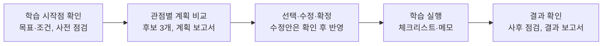

# GrowPath

**개발·운영 직군 AI 역량 성장 지원 서비스**
피드백을 통한 보완에서 스스로 그리는 성장 로드맵까지

| 항목 | 내용 |
|---|---|
| 과정 | SK네트웍스 Family AI 캠프 33기 최종 프로젝트 2팀 **부산별빛샌드** |
| 주제 | 다중 에이전트 기반 업무 활용 플랫폼 |
| 기간 | 2026.09.28 ~ 2026.11.20 (8주) |
| 팀원 | 송지섭(PM), 신가을(APM), 오호민, 이준희, 김영석 |

> **현재 단계 (10/12 기준)**: 3주차. 기획·설계·데이터 수집 단계이며 서비스 코드는 아직 없습니다. 제출 산출물 5종은 [`docs/`](docs/)에 보관합니다. 공식 제출 링크는 [산출물 관리 시트 2팀 탭](https://docs.google.com/spreadsheets/d/1EQeYN_FpKWzzxHUdtjG9WYaP9t43bvf-H5e1jGMTMEM/edit?gid=1029234216)에서 확인합니다.

<br>

## 1. 프로젝트 소개

| 항목 | 내용                              |
|---|---------------------------------|
| 한 줄 소개 | 개발·운영 직군 직원의 AI 역량 성장을 돕는 서비스   |
| 대상 사용자 | 한국수자원공사의 가상 개발·운영 직무 부서 직원 (AI본부 적용 여부는 확인 필요) |
| 기준 자료 | 한국수자원공사 공개 자료 (규정, AI 활용 사례)    |

| 사용자 | 하는 일 | 볼 수 있는 자료 |
|---|---|---|
| 개인 사용자 | 목표·조건 입력, 사전·사후 점검, 로드맵 후보 선택·수정·확정, 실행 기록, 하단 챗봇 | 본인 자료 |
| 상급자 | 알림을 받고 소속 직원의 성장 계획이 업무에 맞는지 코멘트 | 소속 직원이 올린 로드맵과 진행 상태 |
| 시스템 관리자 | 규정·직원 정보 등록·수정·버전 관리, 교육 수요 집계 정리 (별도 협의) | 운영 자료 (개인 계획 열람 권한과 분리) |

<br>

## 2. 주요 기능



규정 질문은 화면 하단 챗봇으로 언제든 묻고, 상급자는 확정된 로드맵에 코멘트합니다.

| 기능 | 내용 |
|---|---|
| ① 학습 수준 점검 | 목표와 학습 선호에 맞춰 사전 점검 문항을 만들고, 사후에 같은 문항으로 다시 점검합니다. 점수 계산은 프로그램이 합니다 |
| ② 로드맵 후보·계획 보고서 | 같은 목표와 시간·예산 한도 안에서 관점(예: 비용·시간·업무 적용)만 다른 후보 3개를 만들고 비교합니다. 수정 요청은 수정안을 먼저 보여 주고 확정 전까지 기존 로드맵을 유지합니다 |
| ③ 실행·결과 보고서 | 활동 완료 여부와 메모를 기록하고, 사후 점검 뒤 변화·보완점·다음 계획을 정리합니다 |
| ④ 하단 챗봇 | 등록된 규정 원문에서 조항을 찾아(RAG) 대상·한도·승인·기간을 대조해 답합니다. 근거가 없으면 확인할 수 없다고 안내하고, 규정 외 일반 질문은 일반 답변으로 표시합니다. 로드맵·점검 요청은 메뉴로 안내하며, 승진·발령·보수·성과급 상담은 답하지 않고 다룰 수 없다고 안내합니다 |
| ⑤ 상급자 코멘트 | 확정된 로드맵에 상급자가 코멘트하고, 직원은 이를 반영해 로드맵을 고칠 수 있습니다 |

<br>

## 3. 시스템 구성

| 에이전트 | 하는 일 | 만드는 결과 |
|---|---|---|
| 규정 RAG | 하단 챗봇의 규정 질문과 로드맵 후보의 지원 조건 확인 | 답변, 근거 조항, 적용 조건, 미확인 사항 |
| 로드맵 계획 (LoRA) | 하위 에이전트 3개(A1 비용, A2 시간, A3 업무 적용 우선)가 후보를 병렬 작성 | 관점별 후보, 계획 보고서, 수정안 |
| 진단 | 점검 문항 생성, 시작점·보완 방향 제안, 결과 보고서 작성 | 생성 문항, 점검 요약, 결과 보고서 |

- LangGraph가 요청과 상태에 따라 실행 순서를 정합니다. 순서를 정하는 LLM은 따로 두지 않습니다.
- 계산·저장·알림과 권한·형식 검사는 프로그램이 처리합니다.

| 저장소 | 보관 내용 |
|---|---|
| 원문 파일 | 규정 PDF와 개정본 (문서 ID, 버전) |
| 관계형 DB | 사용자·평정·학습자료, 점검·선택·로드맵 이력, 보고서·코멘트 |
| 벡터 색인 | 규정·학습자료 색인 (개인 점검·평정·로드맵은 넣지 않음) |
| 실행 기록 | 호출·검사·모델·관점 버전 |

<br>

## 4. 모델링 계획

| 구분 | 기준 방식 | 비교 후보 |
|---|---|---|
| 에이전트 구성 | 단일 에이전트 | 메인 3개 + 관점별 하위 3개 |
| 로드맵 모델 | 기본 모델 + 지시문 (학습 전) | Qwen3.5-9B + LoRA 또는 QLoRA |
| 요청 분류 | TF-IDF + 로지스틱 회귀 | 한국어 사전학습 분류 모델 |
| 검색 | 역량–자료 매핑표 | 벡터 유사도 검색으로 보충 |

비교 실험은 한 번에 하나만 바꿉니다: A/B 에이전트 구성, B/C 학습 전후(어댑터 유무), D 모델 후보(여유 시), E 후보 작성 방식, F 관점 설정 vs 관점별 어댑터, G LoRA vs QLoRA.

| 대상 | 평가 지표 |
|---|---|
| 규정 상담 | 규정 근거 적합성, 허위 조항 |
| 로드맵 후보 | DB에 없는 자료, 시간·예산 위반, 관점 위반, 요청 밖 변경, 평가표 점수(검토자 2명) |
| 요청 분류 | macro-F1, 혼동 사례 |
| 서비스 전체 | 정상 요청 완료율, 처리 시간 |

<br>

## 5. 데이터

| 데이터 | 출처                                          | 확보 현황 (10/8) |
|---|---------------------------------------------|---|
| 기관 규정 | 한국수자원공사 규정 (직접 확보)                          | 28종 |
| AI 활용 사례 | 한국수자원공사 「공공기관 AI 활용 사례 총괄표」                 | 16건 |
| 외부 학습자료 | K-MOOC, KOHI, GSEEK, 도서관 정보나루, 자격 정보, 공식 문서 | 10개 과정 조사 (입문·업무 활용 위주) |
| 가상 직원 사례 | 팀원 5명 기반 가상 직원·상급자 (상급자는 강사님 또는 멘토님도 고려)    | 설계 중 |
| 파인튜닝 데이터 | 가상 프로필 + 모델 초안 + 사람 검토 (구축 계획)          | 형식 확인용 초안 36건 (규칙 기반 생성, 검토 전) |
| 요청 분류 데이터 | 팀 작성 질문 + 생성 문장 (규정·일반·범위 밖 3개 유형)     | 3주차 구축 예정 |

팀원 정보는 동의한 범위에서만 쓰고 저장소에 올리지 않습니다.

<br>

## 6. 진행 현황 (10/12 기준)

| 주차 | 산출물 | 상태 |
|---|---|---|
| 1주 | [요구사항 정의서](docs/01_요구사항_정의서/요구사항_정의서_33기_2팀.xlsm), [WBS](docs/02_WBS/WBS_33기_2팀.xlsx) | 제출 |
| 2주 | [프로젝트 기획서](docs/03_프로젝트_기획서/GrowPath_기획서_33기_2팀.docx), [수집 데이터 보고서](docs/04_수집_데이터_보고서/수집_데이터_보고서_33기_2팀.docx), [화면 설계서](docs/05_화면_설계서/화면_설계서_33기_2팀.pdf) | 제출 |
| 3주 | DB·저장소 설계 문서 | 진행 중 (WBS 2.2, 40%) |
| 3주 | 데이터 전처리 결과서 | 진행 중 (WBS 2.3, 20%) |
| 3주 | 중간발표 자료 | 준비 중 |

저장소의 5종은 2026-10-13 공식 제출 링크에서 내려받은 스냅샷입니다. 원본의 마지막 수정일은 모두 2026-10-12이며, WBS는 Google Sheets에서 XLSX로 내보냈습니다. 원문에 남은 보류·협의·미확인 항목은 그대로 유지합니다.

**한 일**: 주제 확정 후 재기획, 1~2주차 산출물 5종 제출, 수자원공사 규정 28종·AI 활용 사례 16건 확보

**남은 과제**
- 로드맵에 쓸 외부 학습 과정 추가 확보와 K-MOOC 연동
- 요청 분류 데이터 구축, 점검 문항 생성 규칙·점수 기준 확정
- 고정 시험 30개의 기대 결과 작성
- WBS의 담당 미정 작업 배정, DB·임베딩 모델, GPU 예산 결정

<br>

## 7. 향후 일정

| 주차 | 기간 | 주요 작업 | 산출물 |
|---|---|---|---|
| 4주 | 10/19~10/23 | 요청 분류 2종 학습·비교, 규정·학습자료 색인, K-MOOC 연동, DB 구축 | ML/DL 학습결과서, 학습한 모델, 벡터DB 구축 결과서 |
| 5주 | 10/26~10/30 | 에이전트 3종 구현, LoRA/QLoRA 학습 | AI 시스템 아키텍처 |
| 6주 | 11/2~11/6 | 비교 실험, 기능·모델 동결 | 멀티 에이전트 테스트 보고서(필요시 sLLM 파인튜닝 평가 포함), 시스템 구성도 |
| 7주 | 11/9~11/13 | 통합 테스트, 결함 개선 | 서비스 테스트 보고서 |
| 8주 | 11/16~11/20 | 배포 점검, 시연 영상, 최종 발표 | 웹 애플리케이션, 최종 발표 자료, 소스코드, 시연영상 |

<br>

## 8. 기술 스택 (계획)

| 구분 | 계획 |
|---|---|
| 에이전트 실행 | LangGraph |
| 생성 모델 | Qwen3.5-9B + LoRA/QLoRA (비교: Qwen3.8-27B) |
| 요청 분류 | TF-IDF + 로지스틱 회귀, 한국어 사전학습 분류 모델 |
| 학습 환경 | RunPod GPU 대여 (A40 48GB 1장 후보, 메모리 실측 전) |
| 저장소·임베딩 모델 | 관계형 DB + 벡터 색인. 제품과 임베딩 모델은 비교 후 결정 |
| 웹 | 미정 |

<br>

## 9. 역할 분담

| 팀원 | 담당 |
|---|---|
| 송지섭 (PM) | 일정·산출물 관리, 직원 데이터 설계 |
| 신가을 (APM) | 서기, 규정 데이터 전처리 및 DB 설계, 세부 기획 |
| 오호민 | DB 및 데이터 구조 설계, sLLM 파인튜닝 |
| 이준희 | 프로그램 화면 설계, 요청 분류 데이터 정리 |
| 김영석 | 프로그램 화면 설계, 중간 발표 |

직원 데이터 설계·요청 분류 데이터 정리·sLLM 파인튜닝 담당의 확정 여부는 팀 확인이 필요합니다. 개발 세부 담당은 GitHub 이슈의 Assignees를 기준으로 확인합니다.

<br>

## 10. 저장소 구조

```
docs/
├── 01_요구사항_정의서/   요구사항 정의서 (XLSM)
├── 02_WBS/               WBS (XLSX)
├── 03_프로젝트_기획서/   프로젝트 기획서 (DOCX)
├── 04_수집_데이터_보고서/ 수집 데이터 보고서 (DOCX)
└── 05_화면_설계서/       화면 설계서 (PDF)
.github/
└── ISSUE_TEMPLATE/
    ├── task.md           작업 요청 템플릿
    └── bug_report.md     버그 보고 템플릿
AGENTS.md                 코딩 에이전트 작업 규칙
README.md                 프로젝트 소개와 협업 안내
```

서비스 코드 폴더는 개발을 시작하면 추가합니다.

<br>

## 11. 협업 방식

상세 작업 규칙은 [AGENTS.md](AGENTS.md)를 따릅니다.

- 일정·WBS는 [팀 Notion](https://app.notion.com/p/ohgiraffers/SKN33_FINAL_2-_-3e9649136c1180f6b847e176dd888c98), 개발 작업은 [GitHub Issues](https://github.com/20260528-skn-family-ai-33/SKN33-Final-2Team/issues)에서 관리합니다.
- 최신 `main`에서 `종류/이슈번호-짧은-설명` 브랜치를 만들고 PR로 병합합니다. 작성자 외 1명 이상의 승인이 필요하며 AI 리뷰는 사람 승인을 대신하지 않습니다.
- 커밋·PR 제목은 `type: 변경 내용 (#이슈번호)` 형식입니다 (`feat`, `fix`, `docs`, `refactor`, `test`, `chore`).
- 오타·링크 수정, 단순 산출물 업데이트, 이미 합의된 내용이나 확인된 현황의 문서 간 동기화는 이슈 없이 PR만 올릴 수 있습니다. 이때 브랜치는 `docs/짧은-설명`, 커밋·PR 제목은 `docs: 변경 내용`으로 씁니다. 기능·코드·공통 계약 변경이 함께 포함되면 이슈를 기준으로 진행하며, 커밋·푸시 승인과 사람 리뷰 규칙은 그대로 적용합니다.
- API 키 같은 비밀값, 개인정보, 모델 가중치, 대용량 데이터는 저장소에 올리지 않습니다.
