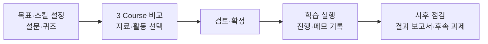
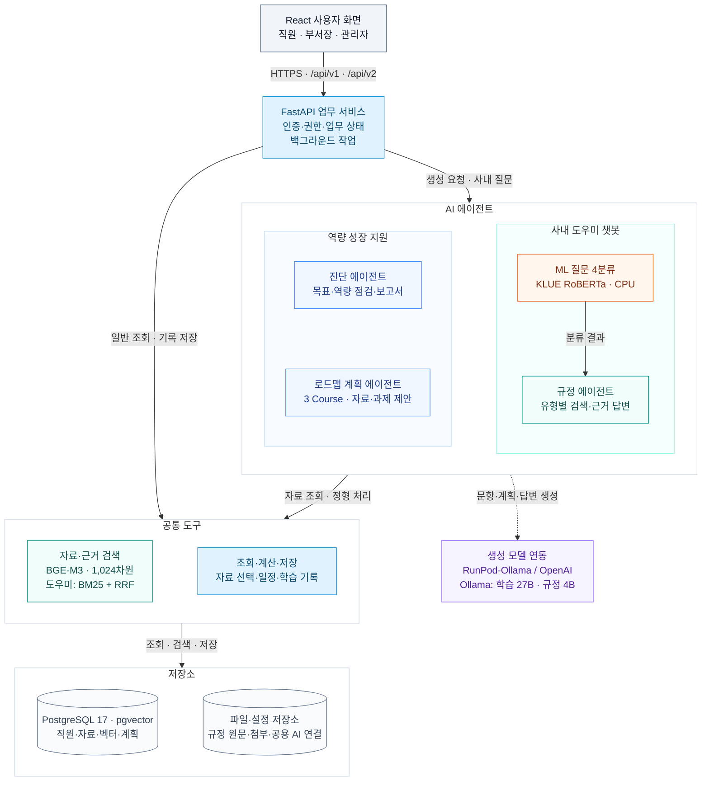

# GrowPath

**업무 목표에서 학습 계획, 실행과 돌아보기까지 이어지는 AI 역량 성장 지원 서비스**

서비스 접속: **[growpath-edu.site](https://growpath-edu.site/)**

GrowPath는 개발·운영 직군 직원이 업무에 필요한 스킬을 고르고, 실제 학습 자료로 개인 로드맵을 만들어 실행하도록 돕습니다. 사내 생활 도우미는 등록된 규정과 회사 자료를 근거로 질문에 답하고, 부서장은 확정된 팀원 계획에 피드백을 남기거나 사후 점검 결과 보고서를 보고 후속 과제를 부여합니다.

[주요 기능](#2-주요-기능) · [AI와 시스템 구조](#4-ai와-시스템-구조) · [AI 에이전트](#5-ai-에이전트) · [산출물](docs/README.md) · [실행 방법](#11-개발-환경-실행)

## 1. 프로젝트 소개

| 항목 | 내용 |
| --- | --- |
| 과정 | SK네트웍스 Family AI 캠프 33기 최종 프로젝트 |
| 팀 | 2팀 **부산별빛샌드** — 송지섭(PM), 신가을(APM), 오호민, 이준희, 김영석 |
| 기간 | 2026.09.28 ~ 2026.11.20 |
| 대상 | 한국수자원공사 공개 자료와 조직을 바탕으로 한 개발·운영 직군 가상 직원 |
| 목적 | 업무 목표를 필요한 스킬과 학습 활동으로 구체화하고, 실행 기록과 사전·사후 점검으로 다음 학습 방향 정하기 |

공개 규정·학습 자료와 가상 직원 데이터를 사용하는 교육 프로젝트입니다. 실제 기관의 인사 시스템·SSO와 연동된 운영 서비스는 아닙니다.

### 역할 분담

| 팀원 | 주요 역할 |
| --- | --- |
| 송지섭(PM) | 직원·로드맵 추천 데이터 고도화, 학습 자료 추천·일정 |
| 신가을(APM) | 프로젝트 기획, 사내 규정 데이터 수집·정제·관리 |
| 오호민 | DB·벡터 검색 초기 설계, 진단·로드맵 에이전트 개발·파인튜닝 |
| 이준희 | React UI 설계·프런트엔드 개발 |
| 김영석 | 사내 생활 도우미 질문 분류, 에이전트 개발·파인튜닝 |

## 2. 주요 기능

| 기능 | 사용자가 할 수 있는 일 |
| --- | --- |
| 목표·스킬 설정 | 업무 목표를 입력하거나 추천 목표를 고르고, 기획서 요약과 본인 프로필을 바탕으로 학습할 스킬을 최대 3개 선택합니다. |
| 사전 역량 테스트 | 스킬별 공통 설문과 프로젝트에 맞춘 퀴즈에 응답하고, 저장된 설문 응답과 퀴즈 정오답·해설을 확인합니다. |
| 3 Course 비교 | Free·Crash·Challenge 계획을 고르고 강좌·도서를 편집합니다. 다른 코스의 자료와 비교하거나 스킬별 산출물 과제를 골라 확정할 수 있습니다. |
| 학습 실행 | 현재 주차의 활동을 확인하고 진행 상태·메모·선택 첨부를 기록합니다. 같은 로드맵의 동일 강좌는 하나로 묶어 상태를 공유하고 메모·첨부는 활동별로 보존합니다. 도서는 참고 자료로 확인합니다. |
| 사후 점검·보고서 | 사전과 같은 설문, 같은 개념·난이도의 새 퀴즈로 돌아봅니다. 실행 기록과 응답 변화로 보고서가 생성·저장되면 로드맵을 완료하고 본인과 부서장에게 알립니다. |
| 사내 생활 도우미 | 질문을 규정·회사·사내 생활·범위 밖으로 분류하고, 해당 자료와 공개 범위에 맞춰 답변하거나 이용 가능한 메뉴를 안내합니다. |
| 부서장·관리자 | 부서장은 확정 후 진행 중인 소속 직원 계획에 코멘트를 남기고, 결과 보고서에서 별도 후속 과제를 부여합니다. 관리자는 직원·조직·자료·규정과 공용 AI 연결을 관리합니다. |

## 3. 학습 흐름



작성 화면은 **목표·기획서 → 세부사항·스킬 선택 → 입력 내용 확인 → 역량 테스트 → 테스트 결과 → 로드맵·자료 선택 → 검토·확정**의 7단계입니다. 로드맵·자료 단계에서는 세 코스 중 하나를 고른 뒤 자료를 편집하고, 필요하면 3열 비교를 엽니다. 검토 단계에서는 이름·기간·시간·비용과 주차별 일정을 확인하고 스킬별 산출물 과제를 비교·선택하거나 과제 없이 확정할 수 있습니다. 새 계획 확정 시 기존 계획과 함께 진행하거나 기존 계획을 사후 점검·보관하는 방식을 선택합니다.

| Course | 작성 관점 |
| --- | --- |
| **Free** | 현재 가격이 확인된 0원 강좌만 사용합니다. |
| **Crash** | 초·중급 강좌 중 목표에 필요한 내용을 짧게 학습하는 구성을 우선합니다. |
| **Challenge** | 중상·상급 강좌 중 실제 업무 적용·실습 근거를 우선하고, 근거가 같으면 상급 강좌를 우선합니다. |

세 Course 모두 사용자가 고정한 선택 스킬을 유지합니다. 교육 예산을 **0원으로 입력하면 모든 코스에서 현재 가격이 확인된 무료 강좌만** 추천·신규 선택할 수 있습니다. 예산 미입력은 0원과 구분하며, 적합한 무료 강좌가 없으면 선택을 비우고 이유를 안내합니다. Crash·Challenge의 기존 계획 수정에서 같은 활동의 동일 강좌를 유지하는 경우는 보존합니다.

도서는 가격을 수집하지 않으므로 세 코스 모두 **비용을 0원으로 계산하고 가격을 표시하지 않습니다**. 참고·메모용 자료로 제공하며 학습 시간·주차·진척률·완료 수에 포함하지 않습니다. 같은 강좌를 여러 스킬에서 선택하면 시간·비용은 한 번만 합산하고, 연결된 활동이 모두 완료되어야 완료 강좌로 셉니다. 신규·수정 계획의 강좌 기간은 주당 학습 시간으로 계산하며, 여러 스킬이 공유하는 강좌에는 1주를 추가합니다. 기존 확정 계획은 조회만으로 일정을 다시 계산하지 않습니다.

신규 테스트는 **설문+퀴즈**로 구성합니다. 스킬 1개는 설문 5개·퀴즈 5개, 2~3개는 스킬마다 설문 3개·퀴즈 3개입니다. 설문은 DB에 미리 저장한 스킬별 공통 문항을 우선 사용하고, 풀이 없거나 사용할 수 없으면 해당 진단의 설문 전체를 모델로 생성합니다. 퀴즈는 프로젝트에 맞춰 설문에 응답하는 동안 생성합니다. 신규 작성에서 자격증을 선택하지 않으며 관련 자격증은 로드맵 참고 추천으로 제공합니다. 설문 변화는 자기보고이며 실제 업무 능력이나 인사평가의 확정 판정으로 사용하지 않습니다.

## 4. AI와 시스템 구조



화면의 `/api/v1`·`/api/v2` 요청은 FastAPI 업무 서비스가 인증·권한·입력·진행 상태를 확인해 처리합니다. 진단·로드맵 계획·규정 에이전트는 서버 내부의 역할별 모듈입니다. 일반 조회·저장은 업무 서비스와 공통 도구가 담당하고, 생성이 필요한 요청만 모델로 연결합니다. 화살표는 요청·자료 접근 관계이며 결과는 API를 거쳐 화면으로 돌아옵니다.

사내 도우미 질문은 **ML 질문 분류(KLUE RoBERTa) → 분류 결과 전달 → 사내 도우미 챗봇(규정 에이전트)**으로 이어집니다. 규정 에이전트는 규정·회사 정보·사내 생활·범위 밖이라는 분류 결과에 따라 검색할 자료와 답변 방식을 정합니다. ML 분류의 신뢰도가 80% 미만이거나 없으면 선택한 LLM으로 한 번 재분류하며, 범위 밖 질문에는 이용 가능한 메뉴를 안내합니다.

자료 추천은 **스킬·종류·이용 조건 필터 → 목표·프로젝트·선택 스킬 맥락의 임베딩 → pgvector 검색 → 후보 검토 → 모델 추천 → 사용자 선택 → 확정 시 재검증** 순서입니다. 코스별 강좌는 상위 후보 최대 20개에서 실제 목차·실습과 목표의 관련성을 검토하고, 모델에는 스킬별 최대 6개를 전달합니다. 직접 후보가 부족하면 같은 조건과 실제 학습 근거를 갖춘 보충 강좌를 검토하며, 유효 자료가 부족하면 수량을 강제로 채우지 않습니다. 본인이 이수한 강좌와 중복 자료는 제외합니다. 도서는 같은 사전 점검의 스킬별 검색 결과를 세 코스가 공유하고, 중복을 뺀 공통 후보는 최대 30권입니다. 최종 추천은 코스별·스킬별 강좌·도서 각각 최대 3개이며, 선택 저장과 확정 때 현재 카탈로그·가격·스킬 조건을 다시 검사합니다.

| 구성 | 현재 역할 |
| --- | --- |
| KLUE RoBERTa | 사내 도우미 질문을 4분류하고 결과를 규정 에이전트 챗봇에 전달합니다. 로컬 CPU 추론이며 모델 파일·manifest를 별도로 준비합니다. |
| 팀 파인튜닝 27B · Q4_K_M | 목표·스킬·퀴즈·로드맵·보고서 등 학습 계획 생성. Ollama 이름은 `growpath-27b`이며 모든 역할에서 추론 모드를 끕니다. |
| 팀 파인튜닝 4B · BF16 | 규정·회사 질문 답변. Ollama 이름은 `growpath-regulation-4b`이며 추론 모드는 항상 끕니다. |
| OpenAI 생성 모드 | 관리자 정책에 따라 공용으로 지정하거나 직원이 선택하는 생성 경로입니다. 모델은 서버 설정, 추론 정도는 관리자 또는 허용된 직원 설정을 따릅니다. |
| `BAAI/bge-m3` | 규정·회사 정보·사내 생활·강좌·도서 등 전체 검색용 1,024차원 모델입니다. 공식 고정 revision의 CPU 서버에서 기본 FP32 추론·CLS·FP32 L2 정규화로 질문을 임베딩합니다. |

[분류 모델 연결](backend/classification.md) · [27B 모델 안내](backend/models/fine_tunning/README.md) · [RunPod 연결·27B/4B 모델 준비](backend/RunPod_Ollama_연결_절차.md)

현재 설치·DB 연결은 [공유 BGE-M3 DB 연결](backend/README.md#공유-bge-m3-db-연결-124)을 따릅니다. 동반 manifest로 확인한 공유 백업을 별도 `growpath_bge_m3`에 복원하고 저장된 BGE 벡터를 재사용합니다. #124 기본 공유본의 4,832개는 해당 백업의 기록이며 이후 사내교육 확충본과 구분합니다. 생성 LLM 선택은 검색 임베딩과 별개입니다.

사내 도우미는 **BM25 + BGE-M3 pgvector → RRF → 같은 부모 조항 문맥 보충**, 학습 자료 추천은 기존 가격·스킬·코스 범위를 유지한 BGE-M3 pgvector 검색을 사용합니다. 기존 벡터를 재생성하지 않습니다.

## 5. AI 에이전트

| 에이전트 | 하는 일 |
| --- | --- |
| 진단 | 직원 프로필에서 목표 후보를 제안하고, 기획서를 요약해 목표에 맞는 스킬을 추천합니다. 공통 설문 풀과 프로젝트별 퀴즈로 점검을 구성하고, 사전·사후 응답과 실행 기록으로 보고서 피드백을 작성합니다. |
| 로드맵 계획 | 같은 목표와 확정 스킬을 바탕으로 Free·Crash·Challenge 세 안을 작성합니다. 검색된 강좌·도서 후보에서 자료를 추천하고 스킬별 실습 과제와 역량 요약을 제안합니다. 선택 자료의 학습 활동과 일정은 서버가 구성·검증하며, 누락된 과제만 한 번 보완 요청합니다. |
| 규정 | 사내 생활 도우미에서 질문을 규정·회사 정보·사내 생활·범위 밖으로 분류하고, 직원군과 공개 범위에 맞는 자료로 답합니다. 근거가 없거나 일부만 확인되면 그 상태를 구분해 안내합니다. 로드맵 3안 생성에서는 교육비 규정 원문을 초안당 한 번 조회하며, 지원 대상과 예산은 교육담당자에게 확인합니다. |

## 6. 데이터와 저장

공개 규정, 외부 강좌·도서·자격 자료, 스킬 매핑, 회사 정보와 가상 사내 생활 안내를 사용합니다. 데모 직원 프로필과 본인 입력은 목표·스킬 추천의 맥락으로 연결합니다.

PostgreSQL은 프로필·초안·확정 계획·버전·자료 선택·활동·점검·보고서·코멘트·후속 과제·알림을 저장하고, pgvector는 자료·규정·회사·사내 생활 검색 벡터를 저장합니다. 별도 GraphDB는 사용하지 않습니다. 관리자 공용 AI 정책과 연결 키는 DB가 아닌 서버 영속 볼륨 파일에 저장하며 조회 응답에 키 원문을 보내지 않습니다.

DB 백업·규정 원문·모델 가중치는 저장소 밖에서 전달합니다. 백업은 **함께 전달된 manifest의 크기·SHA-256**으로 확인합니다. 저장소에 추적된 과거 manifest를 최신 공유본의 해시로 대신 사용하지 않습니다.

[DB 코드와 검사](database/README.md) · [백업·규정 원문 준비](team_db/README.md) · [복원 상세와 이전 이력](database/RESTORE.md)

## 7. 역할과 공개 범위

| 역할 | 공개·수정 범위 |
| --- | --- |
| 직원 | 본인의 입력·초안·계획·활동·점검·보고서를 작성·조회하고, 부서장 후속 과제에 글·파일로 결과를 제출합니다. 본인 비밀번호를 변경할 수 있습니다. |
| 같은 기관·부서의 부서장 | 직원이 **계획 작성을 마치고 확정한 로드맵부터** 조회합니다. 진행 중 계획에는 코멘트를 작성하고, 사후 점검 결과 보고서가 있는 로드맵에는 별도 입력창으로 후속 과제를 부여해 제출 결과를 확인합니다. 마침·보관 계획의 본문은 읽기 전용입니다. |
| 시스템 관리자 | 직원·조직·학습 자료·규정 데이터와 공용 AI 제공자·연결을 관리합니다. 인사평가 입력은 제공하지 않으며, 관리자 데이터 운영 권한과 개인 학습 원본 열람 권한은 구분합니다. |

미확정 초안과 개인 설문·퀴즈 원본, 메모·첨부·평정 등은 부서장에게 공개하지 않습니다. 부서장 코멘트가 확정 계획을 자동 변경하지 않으며, 직원이 수정안을 검토·확정해야 반영됩니다.

보고서는 생성·저장과 함께 확정되며 직원의 별도 확인 버튼을 완료 조건으로 두지 않습니다. 부서장 후속 과제는 계획의 산출물 과제·코멘트와 별개이고, 직원은 글·파일 중 하나 이상으로 한 번 제출합니다. 과제 부여와 제출은 상대방에게 알립니다. 알림함에는 최근 24시간의 읽은 알림도 남기고 읽지 않은 알림을 먼저 표시합니다.

## 8. 기술 스택과 저장소

| 영역 | 구성 |
| --- | --- |
| 화면 | React 19 · TypeScript · Vite · React Router · TanStack Query · Zustand |
| API·서비스 | Python 3.12 · FastAPI · SQLAlchemy · psycopg |
| 데이터·검색 | PostgreSQL 17 · pgvector |
| AI | Transformers · PyTorch CPU · RunPod-Ollama · OpenAI |
| 실행 | Docker Compose · nginx |
| 검사 | Vitest · ESLint · TypeScript · Python unittest · GitHub Actions |

```text
frontend/          사용자·부서장·관리자 화면, API 연결, 비교용 테마
backend/           FastAPI 백엔드, AI 역할, 저장·권한 서비스
└── models/        질문 분류 실행 파일·실험 자료, 27B 모델 안내
database/          DB 코드·마이그레이션·전처리·검색·복원 도구
team_db/           외부 백업·규정 원문을 넣는 위치와 준비 안내
docs/              기획·설계·데이터·모델 산출물과 파일 manifest
scripts/           빈 DB의 최초 백업 복원 스크립트
docker-compose.yml DB·초기 준비·API·화면 실행 구성
```

화면 테마는 templatemo 기반 두 가지입니다. **라이트 모드**는 `tm464`(464 Ultra Profile), **다크 모드**는 `tm612`(612 Parallax Starter)이고 기본값은 다크 모드·넓은 본문입니다. 로그인 화면은 우측 블록 오른쪽 위, 로그인 뒤에는 상단 메뉴 오른쪽의 해·달 버튼으로 모드를 바꾸고, 그 옆 버튼으로 본문 폭(넓게·이전 폭)을 바꿉니다. 메뉴는 상단 메뉴 하나입니다. 브라우저에는 버튼으로 바꾸거나 `?skin=`으로 연 값만 기억합니다. 테마별 원본 출처는 `frontend/src/skins/<id>/index.ts`에 기록합니다.

## 9. 산출물

[산출물 목록](docs/README.md)에서 요구사항·WBS·기획서·화면설계·수집/전처리·DB/벡터DB·모델·아키텍처 문서를 확인할 수 있습니다. [파일 manifest](docs/artifacts.manifest.json)는 반영 파일의 상대 경로·크기·SHA-256과 원본 링크를 연결합니다.

README의 코드 설명은 **2026-11-15 main [`20f8a14`](https://github.com/20260528-skn-family-ai-33/SKN33-Final-2Team/tree/20f8a146baf1cf0e4ff924e411d5bcaa75ad8f22)** 기준입니다. 저장소 `docs/`에는 11월 15일에 연결된 Drive 파일에 반영한 산출물 11종을 담았습니다. 문서별 본문 갱신·문구 정리 범위는 산출물 목록에서 확인하며, 재현 기준은 manifest의 해시입니다. 화면 캡처와 실험 결과는 각 문서에 표시한 당시 기준을 따릅니다. 공식 제출 현황은 [산출물 관리 시트 2팀 탭](https://docs.google.com/spreadsheets/d/1EQeYN_FpKWzzxHUdtjG9WYaP9t43bvf-H5e1jGMTMEM/edit?gid=1029234216)을 따릅니다.

## 10. 개발과 검증

프런트엔드는 `frontend/`에서 다음 검사를 실행합니다. [GitHub Actions](.github/workflows/frontend-ci.yml)도 같은 순서로 검사합니다.

```bash
npm run typecheck
npm run lint
npm test
npm run build
```

백엔드는 `backend/`에서 `python -m unittest discover -s tests -v`를 사용합니다. DB 준비·복원 상태에 따라 필요한 검사가 달라지므로 [백엔드 안내](backend/README.md)와 [DB 검사 안내](database/README.md)를 함께 확인합니다. 화면 흐름·실제 모델 품질·동시 사용자 검증은 단위 검사와 별도로 수행합니다.

일정·WBS는 [팀 Notion](https://app.notion.com/p/ohgiraffers/SKN33_FINAL_2-_-3e9649136c1180f6b847e176dd888c98), 개발 작업은 GitHub Issues, 변경과 검증은 PR에서 관리합니다. 브랜치·커밋 형식 등 협업 규칙은 [AGENTS.md](AGENTS.md)를 따릅니다.

## 11. 개발 환경 실행

로컬 개발 환경의 설치·실행·AI 연결·업데이트 절차는 [개발 환경 실행 안내](docs/development-setup.md)를 확인하세요.
